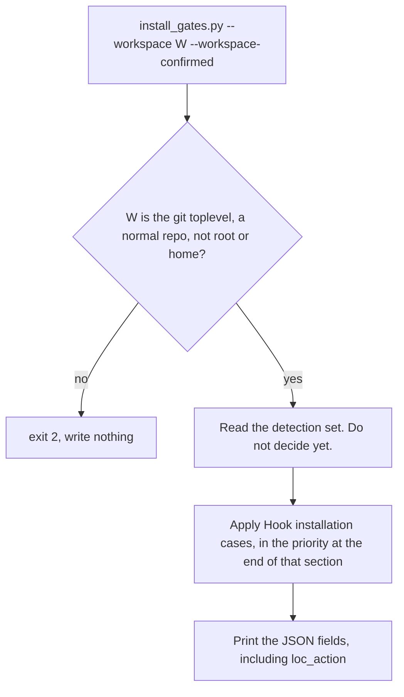
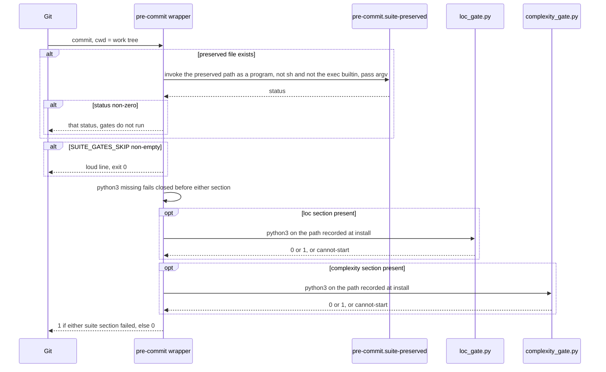
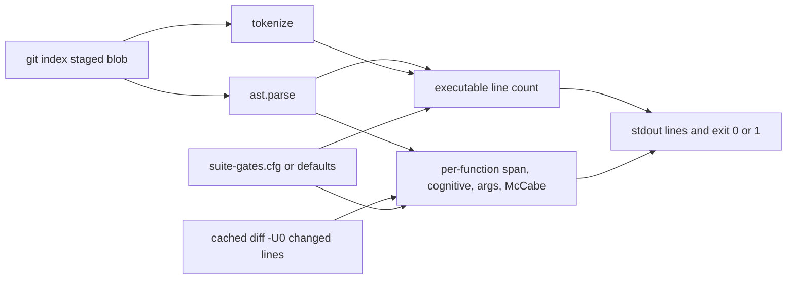

# Commit-scoped Python gates on first `/soc`

| | |
|---|---|
| **Author** | design pass (suite) |
| **Date** | 2026-11-03 |
| **Status** | Draft |
| **Workspace** | this suite repo |
| **Consumers** | `/soc` Phase 0, later callers of the same installer |

This is a design. It does not install a hook, does not run `/soc`, and does not edit a workflow.

---

## Overview

The first time `/soc` runs in a workspace, that workspace gets two commit-scoped Python gates if they are not already there: an executable-line length checker, and a per-function complexity checker. A second run installs nothing the hook git already runs. The length checker is not installed again when the detection set already contains `LOC-EXEMPT` or a suite marker. That checker's unit and ceilings are not read and are not rewritten. Detection does not by itself mean git is executing the file. `length_runs` records that.

Both checkers read the index. They do not read the working tree, and they do not walk files the commit did not stage. For a suite-installed length section, the defaults are 500 executable lines reject, 200 maintenance print, and 150 aim print. 150 and 200 do not reject. 499 against the default reject does not reject. A valid `.githooks/suite-gates.cfg` is the live ceiling for those sections. `reject` less than or equal to 200 fails closed. Complexity fails a touched function whose cognitive complexity is over 15, or whose argument count is over 5 (excluding a leading `self` or `cls`). McCabe is printed only on a function already being rejected or exempted, and it never fails the commit. Untouched functions in a touched file stay legal.

The commits this workflow itself creates are `git add -- <paths>` and then one unexported `SUITE_GATES_SKIP=1 git commit -m <message> -- <same paths>`. On git 2.34.1 a `git commit -- <path>` while that path is still untracked exits 1 before the hook. Those commands are written in the Phase 0 insertion, because that is the text the agent will have. Every other commit is gated. `git revert` is not prefixed and does not run pre-commit. A clean preflight is permission to run it, not a guarantee that it creates a commit. A content conflict exits 1 and the recovery is `git revert --abort`. The third preflight command is `git ls-files --others --` the paths from `git diff-tree`, with no `--exclude-standard`. The pass is empty output. That command prints an ignored untracked file on a reverted path, and the agent stops before revert. The generated hook finds the suite through the absolute directory the installer records from its own file location at install time. The design does not name a home directory.

The installer is one program, `scripts/hooks/install_gates.py`, owned by `/soc`. No other workflow gets a copy. `/sentinel` does not gain a write channel.

---

## Background & Motivation

`docs/studies/2026-10-29-code-quality-panel.md` is the measurement this design is allowed to cite. On P-ENG, file length and function shape moved in opposite directions. From 2026-09-01 to 2026-10-29 the share of physical lines in files over 500 lines went from 5.7% to 16.1%, while excess cognitive points per 1,000 code lines ended at 35.6, cognitive p90 at 12.2, and the McCabe-over-10 share at 2.0%. P-AGT-A, measured with no length hook, was worse on shape (excess 80.1, cognitive p90 21, McCabe-over-10 11.3%). The length ratchet did not produce that shape gap by itself, and it cannot see inside a file it has agreed to ignore.

The year-2 section names the hole. FN-PUMP thickened inside an exempt file (cognitive 59 to 125, McCabe 58 to 93). A nested helper, FN-TICK, is cognitive 109 and displays McCabe 1, because the McCabe visitor folds a nested function into its parent and keeps no graph of its own. Argument count on the same engine moved the wrong way relative to P-AGT-A (the panel's PLR0913 rates: 0.64 per 1,000 code lines on the May agent product, 3.4 on the engine). The panel's conclusion, which this design implements rather than re-litigates: a commit-scoped, per-function check, with grandfather and an explicit exemption, scored with the cognitive rules the panel already self-tested. A 500-line file check cannot see FN-PUMP.

`/soc` is the campaign that already tells an agent to split large modules, and it is the invocation the user chose as the installer. Today it has no unit and no gate. Phase 3's success line says a new module is "<250 LOC ideal". Phase 6 says the leftover file is "<300 LOC". `claude-commands/soc.md` lines 195 and 275. The panel's coverage table records those sentences as agent judgment, not a meter.

What this repo already has:

- `scripts/pre-commit-lint.sh` lints staged `claude-commands/*.md` by invoking `python3` on `scripts/suite/lint_workflows.py` under this suite's checkout. It does not look at project Python. The installed copy at `.git/hooks/pre-commit` is that script. `core.hooksPath` is unset in this repo. The script ends in `exit 0`, and it also exits 0 when no workflow markdown is staged, so a line appended after either exit never runs. This design does not copy that script's suite path into the new hook.
- `scripts/gitignore/gitignore_seeder.py` and `scripts/gitignore/config.py` are the create-only / do-not-touch-user-entries pattern. Markers bound the managed block. A missing seed falls back to defaults. `assert_safe_target` refuses the filesystem root and the home-directory root. The CLI writes nothing without `--workspace-confirmed`.
- `scripts/plan/ensure_plan_templates.py` never overwrites non-whitespace content. An empty or whitespace-only file is filled only when `--force` is passed. `/sentinel` does not pass `--force`. The hook installer is stricter than that script: any existing config path, including empty, is not opened for write.
- `scripts/run_tests.sh` is `PYTHONPATH=. python3 -m unittest discover tests/` from `scripts/`. `scripts/tests/test_gitignore.py` is the temp-repo pattern (`tempfile.mkdtemp`, `git init`, local `user.email`).
- `claude-commands/sentinel.md` STRICT RULE 1 allows three writes and no others: `{workspace}/.doorway/` (plus the scan tool's own README self-heal), the managed block of `{workspace}/.gitignore`, and create-only `{workspace}/tasks.md` plus `{workspace}/implementation-plan.md`. The panel's "Sentinel is not the installer" section says a hook is a fourth channel and must not be added quietly.

The panel records that one external project has a 500-line ratchet and an exemption line with a reason, that a god file in that measurement is more than 500 physical lines, and that eighteen of nineteen files over that physical size carried the exemption. It does not name the hook path, the exemption spelling, a 200-line maintenance scan, or a 150-line aim. Those details are not cited from the study. `LOC-EXEMPT` and the 150/200/500 executable triple are settled product rules for the checker this suite installs. A length checker this suite did not write is recognized only by the literal `LOC-EXEMPT` or by this suite's marker. Its unit and its ceilings are unknown to this repo, are not parsed, and are not rewritten. This design does not open another repository.

---

## Goals & Non-Goals

### Goals

- On the first `/soc` run in a workspace, install an executable-line commit checker when that checker is absent. A second run is a no-op for that checker.
- On that same run, install a per-function complexity checker when it is absent. Length present and complexity absent installs only complexity.
- Judge staged Python only. Grandfather everything else.
- Chain onto an existing pre-commit hook without deleting it and without setting `core.hooksPath` in a way that silences `.git/hooks`.
- Recognize an existing length checker by `LOC-EXEMPT` or by this suite's marker, and leave its thresholds alone.
- Ship a stdlib `ast` / `tokenize` implementation. No complexipy, no ruff, no flake8, no network.
- Lock the behavior with unittest temp git repos under `scripts/tests/`, run by `scripts/run_tests.sh`.
- Edit `claude-commands/soc.md` in `/nodelete` style. One installer. No copies.
- Let the commits `/soc` itself creates pass a gate that would otherwise reject the god file they must stage, by a one-shot prefix on a closed list, without turning the gate off.

### Non-goals

- Retuning, reformatting, or replacing a length hook that is already installed.
- Failing a commit on McCabe, nesting depth, Ruff hygiene, format, types, clones, or import cycles.
- Gates for any language other than Python. Non-`.py` staged files are ignored.
- A sentinel write channel, a detect-and-recommend hook step, or an edit to `claude-commands/sentinel.md`.
- Copies of the installer inside `/refactor`, `/testpackage`, `/execute-build`, `/harden`, or `/sentinel`.
- Running `/soc`, or writing a hook into any workspace other than a temp fixture, as part of the build that lands this design.
- An uninstaller, a metrics page, or a change to `scripts/pre-commit-lint.sh`.
- A session-long skip, a campaign-long exemption planted so the god file can be committed, or `--no-verify` as the product escape.
- Opening, quoting, or copying the gitignored panel decode key.

---

## Key Decisions

The first twenty are settled. They are recorded here so a later PR does not reopen them. Decisions after that are this design's resolutions of mechanics the settled items require. They are not new product questions.

1. **First run installs the length checker; second run does not.** `/soc` calls the installer at the start of Phase 0 every time. Idempotence lives in the installer, not in a second prose guess about whether the hook "looks done."

2. **The checker is commit-scoped.** It judges Python blobs in the index. It does not open the working tree for a verdict, and it does not score a file that is not staged. A pure rename with no content hunk is not a touch.

3. **Thresholds, executable lines, for the suite-installed length checker only.**

   | Executable lines | Result |
   |---:|---|
   | `<= 150` | Silence. 150 is not above the aim. |
   | `151–199` | Print the file and the aim. Do not reject. |
   | `200–499` | Maintenance scan. Print the file (it is also above the aim). Do not reject. |
   | `>= 500` | Reject, unless the staged blob has a valid `# LOC-EXEMPT: <reason>`. |

   "Reject at 500", "warn at 200", and "silence under 150" are these boundaries. 499 does not reject. 200 does print. These integers are the defaults the installer writes. A valid `suite-gates.cfg` replaces them for suite-installed sections (decision 28). The band edges then move with `aim`, `maintain`, and `reject`. `reject <= 200` is not a valid config, so the maintenance number cannot become a reject.

4. **An existing length checker is left alone.** Detection is a literal substring scan, not a threshold parser. A file counts as a length checker when it contains `LOC-EXEMPT` or `suite-hook:loc-gate` or `suite-hook:loc-existing`. `LOC-EXEMPT` is the settled detection spelling for a checker this suite did not write. The installer does not read that checker's unit or ceilings and does not rebuild it.

5. **Chain, never replace, and never silence `.git/hooks`.** The four layouts have one procedure, specified in "Hook installation cases" below. `core.hooksPath` is set only when no scope has it set, `.git/hooks` contains no real hook, and the file we need git to run is `.githooks/pre-commit`. It is set `--local` and relative (`.githooks`). It is never set when `.git/hooks/pre-commit` is the hook git would run today.

6. **The two checkers are independent.** Length present and complexity absent installs only the complexity section. Complexity present and length absent installs only the length section. Either may reject. One rejection does not skip the other suite section. A pre-existing hook's non-zero status still short-circuits, because that hook already blocked the commit.

7. **Complexity is commit-scoped and per function.** Which lines count as a touch is decision 37. A `+` line inside the post-image span touches that function. A deleted old line touches a function only when it falls in the pre-image span of the same qualname that still exists. A pure deletion does not mark the surviving neighbor. The span starts at the first decorator line, if any, and ends at `end_lineno`, so a nested function's lines also touch the outer function. The nested function is scored on its own as well. An untouched function in a touched file is not scored. A file-level touch is not a reason to walk every function.

8. **Fail lines for a touched, non-exempt function.**
   - Cognitive complexity `> 15`. Stdlib `ast`. The algorithm is the panel's, including the five self-tests in "Cognitive scorer" below. `return` adds nothing. The AST cannot tell `elif` from `else` plus a sole `if`; both are scored as `elif`.
   - Argument count `> 5`, excluding a leading positional `self` or `cls`. This is the usual PLR0913 default, implemented here so a missing ruff binary cannot fail the commit. Exactly 5 passes.
   - McCabe is printed (edges − nodes + 2; no boolean operators, no ternaries, no comprehension filters). It does not fail the commit. A nested function has no McCabe graph of its own and displays 1. The limitation is printed next to that 1. FN-TICK (cognitive 109, displayed McCabe 1) would slip a McCabe gate; that is why McCabe is not the gate.

9. **Three exemption spellings, each with a non-empty reason, each read from the staged blob.**
   - `# LOC-EXEMPT: <reason>` exempts the whole file from the 500 reject only. It does not exempt cognitive complexity or argument count. That is the FN-PUMP hole, and this gate exists to close it.
   - `# COG-EXEMPT: <reason>` exempts cognitive complexity for that function only.
   - `# ARGS-EXEMPT: <reason>` exempts argument count for that function only.
   - Placement is specified under "Exemption placement." A decorator line is not a valid place.

10. **Executable line, suite checker only.** A physical line that is not blank, not comment-only, and not a docstring-only line. Prose growth must not trip the reject. The counter is `tokenize` plus `ast`, specified below. A syntax error or a decode error rejects the commit and names the error. It is not counted as zero executable lines. An exemption does not forgive a syntax error.

11. **v1 is `.py` only.** Other staged paths are ignored. A commit with no staged Python exits 0 and prints nothing.

12. **One installer, owned by `/soc`.** The implementation path is `scripts/hooks/install_gates.py`. `/refactor`, `/testpackage`, `/execute-build`, `/harden`, and `/sentinel` do not grow a copy. They may later call this script. This design does not add that call, and it does not add a fourth sentinel write channel.

13. **Create-only config.** The installer writes `{workspace}/.githooks/suite-gates.cfg` only when the path is absent and this run actually installed at least one section, or when this run's only write is activating an already-complete dormant hook (decision 29). `os.O_CREAT | os.O_EXCL`. A file that exists, including empty or whitespace, is not opened for write. The hook reads the config. A missing path, and at least one staged Python file, uses the defaults and says so on stdout. A whitespace-only file, a file that does not parse, or a file that breaks the constraints in decision 28 fails closed. A no-Python commit stays silent. Defaults are the numbers in decision 3 and decision 8. They are the defaults, not a second set of ceilings that overrides a valid config.

14. **The generated hook records the suite root at install time.** `install_gates.py` resolves `Path(__file__).resolve().parents[2]`, which is the directory that contains `scripts/hooks/install_gates.py`, and writes that absolute path into the hook as a quoted shell assignment. The hook then runs `python3` on `scripts/hooks/loc_gate.py` and `scripts/hooks/complexity_gate.py` under that recorded directory. The design and the hook template do not contain a home directory or a username. There is no environment override that relocates the suite. If `python3` is missing, the hook prints the reason and exits 1 before either section. If one script cannot be started, the hook prints `SUITE GATES FAILED CLOSED — cannot start <recorded-path>: <reason>`, sets the accumulated status to 1, and still runs the other section. One override, `SUITE_GATES_SKIP`, set to any non-empty value on that one command, lets that one commit proceed past the suite sections. The hook prints a loud line that the gate was skipped. It does not write the variable into git config, the hook file, or the environment of any later command. `/soc` sets it only as a prefix on the closed commit list in decision 22. It does not export it, and it does not set it on any other command.

15. **The 250 / 300 sentences are superseded, not deleted.** The default numbers in `/soc` become aim 150 executable, maintenance scan 200 executable, commit reject 500 executable. A valid `suite-gates.cfg` is the live ceiling for suite-installed sections only. The agent reads `loc_aim`, `loc_maintain`, and `loc_reject` from the installer JSON instead of reciting the defaults as unconditional. The original sentences stay, with a marked replacement under each and a change-log entry appended.

16. **Where the step is injected.** The top of Phase 0 in `claude-commands/soc.md`, once the workspace is the one the user invoked `/soc` on, before the baseline commit, before analysis, and before any extraction. Invocation is the confirmation. The installer does not scan other workspaces. There is no second prompt.

17. **The build that implements this design does not run `/soc` and does not install a hook into a real workspace.** Shipping `scripts/hooks/` plus the `/soc` text is the build. Temp git repos under the test suite are the only write target. Installation happens later, when a person runs `/soc`.

18. **Tests.** `unittest.TestCase` modules in `scripts/tests/`, temp git repos in `setUp` / `tearDown`, same shape as `scripts/tests/test_gitignore.py`. `scripts/run_tests.sh` does not run pytest, and this design does not add a pytest dependency. Pytest would collect the same `TestCase` classes if someone pointed it at the directory; there is no `conftest.py`. The required cases are listed under "Verification."

19. **Marker ids, one per section, so each can be detected alone.**
    - `suite-hook:loc-gate` — the suite length section.
    - `suite-hook:complexity-gate` — the suite complexity section.
    - `suite-hook:chain` — the wrapper or the generated header. Not a checker.
    - `suite-hook:loc-existing` — the wrapper's record that a length checker was already present and was not installed.
    - `suite-hook:set-hooks-path` — present only when this installer set local `core.hooksPath` to `.githooks`. Detection stays a literal substring scan. The generated bytes contain that substring only as its own line, `# suite-hook:set-hooks-path`, in the file git will run after this run set the config. A case-4 wrapper does not contain the substring. A comment that mentions the token would be a false positive, so no generated comment mentions it.

20. **Public-repo privacy.** The design and the implementation cite the panel only through `docs/studies/2026-10-29-code-quality-panel.md` and the acronyms P-ENG, P-AGT-A, FN-PUMP, FN-TICK, plus snapshot labels already in that file. No external project name, no home-directory path, no foreign function or module name, no foreign commit id. The decode key stays closed.

21. **Equality and bands** are decision 3. Stated again because off-by-one here is a false reject: against the defaults, `>= 500` rejects, `>= 200` is the maintenance print, `> 150` is the aim print. Against a valid config the same edges are `>= reject`, `>= maintain`, and `> aim`. `reject <= 200` is not applied. The hook fails closed instead. 499 against the default reject of 500 does not reject.

22. **Phase 0 runs the installer before the baseline commit, then a closed list of `/soc` commits uses a one-shot skip.** The gate stays installed for the whole campaign. It is not turned off. The deadlock is that the baseline commit and every extraction commit stage the god file, and an added module marks every function in that file touched. Those commits cannot both shrink the file and pass a gate that judges the staged blob. The escape is `SUITE_GATES_SKIP` on the one command this workflow is about to run, and nowhere else. The Phase 0 insertion names every such command, because `soc.md` will not contain this design. That list is the seven `git commit -m` lines already in the workflow and the Phase 4 and Phase 5 commits the best-practice bullet tells the agent to make (those phases have no `-m` of their own). Each one is `git add -- <those paths>` and then `git commit -m <message> -- <those paths>`. On git 2.34.1, `git commit -- <path>` for a path git does not yet know exits 1 with `pathspec did not match any file(s) known to git` and the hook does not run. `git add -A` is not the sequence. `git revert` is not on the list. On git 2.34.1, `git revert HEAD --no-edit` and `git revert <commit>` do not run the pre-commit hook or the commit-msg hook. Prefixing `SUITE_GATES_SKIP` does not change that. The preflight is permission to run the command. A clean result can still produce no commit. Before either revert, `git diff --cached --quiet` and `git diff --quiet --` the paths that revert would change must both exit 0, and `git ls-files --others --` those same paths must print nothing. `git ls-files` exits 0 even when it prints a path, so the pass is empty output. Those paths are the output of `git diff-tree --no-commit-id --name-only -r HEAD` for `git revert HEAD`, and of `git diff-tree --no-commit-id --name-only -r <commit>` for `git revert <commit>`, each path its own argument after `--`. If either quiet check exits 1, or `git ls-files` prints a path, stop. Do not revert, do not `git add`, do not `git stash`, do not `git checkout --` the dirty path, and do not delete the untracked file. A staged change, including a file the revert does not touch, makes revert exit 128 with `your local changes would be overwritten by revert`. An unstaged edit of a path the revert would change leaves `git diff --cached --quiet` at 0 and still makes revert exit 128 with `Your local changes to the following files would be overwritten by merge`. An untracked file on a path the revert would recreate, ignored or not, leaves both quiet checks at 0. The check is `git ls-files --others --` that path. It does not pass `--exclude-standard`. That flag drops ignored paths. The pass is empty output. The command exits 0 even when it prints a path. On git 2.34.1, HEAD deleted `gone.py`, `.gitignore` contains `gone.py`, and the worktree file contains `ignored-keep`. `git ls-files --others --exclude-standard -- gone.py` prints nothing and exits 0. `git ls-files --others -- gone.py` prints `gone.py` and exits 0. Stop. Do not revert. Do not delete the file. A revert run anyway exits 0, creates `Revert "delete"`, leaves no `.git/REVERT_HEAD`, and replaces the bytes with `original`. A file ignored by a directory pattern `sub/` is the same: `git ls-files --others -- sub/gone.py` prints `sub/gone.py`, `--exclude-standard` prints nothing, and a revert run anyway exits 0 and replaces the bytes. A non-ignored occupant containing `keep-me` is also printed by `git ls-files --others -- gone.py`. A revert run anyway exits 128 with `untracked working tree files would be overwritten by merge`, creates no `.git/REVERT_HEAD`, and leaves `keep-me`. If `git diff-tree` prints no path, do not run `git ls-files --others` with an empty path list. With no path arguments that command prints every untracked path, ignored or not. An unstaged edit of any other tracked path, an unrelated untracked file, and an unrelated ignored file are not a refusal. A whole-tree `git diff --quiet` is not the extra check. On git 2.34.1 a content conflict is `base`, then commit `A` setting a line, then commit `B` changing that same line, with a clean index and no unstaged edit. Both quiet checks exit 0 and `git ls-files` prints nothing. `git revert --no-edit <A>` exits 1. Stdout contains `CONFLICT (content): Merge conflict in` the path. Stderr contains `could not revert` and hints `git add/rm` then `git revert --continue`, or `git revert --abort`. `git status --short` is `UU` for that path. The index has unmerged stages. `.git/REVERT_HEAD` exists. HEAD is still `B`. Do not `git add` the conflict. Do not `git revert --continue`. Do not `git revert --skip`. The required recovery is `git revert --abort`. On this git that exits 0, removes `.git/REVERT_HEAD`, clears the unmerged index stages, and restores the index and the worktree of the conflicted path to HEAD. HEAD does not move. The status is empty. Then stop. If `git revert` exits non-zero and `.git/REVERT_HEAD` does not exist, do not run `--abort`. Stop and leave the worktree. The completion commit's only path is `SOC_MANIFEST.md`. The Phase 8 `cat >>` of `.workflow_state/receipts/SOC_RECEIPTS.md` is not on that `git add` or that `git commit`. `.workflow_state/` is gitignored. Do not `git add -f` it. The agent does not export the variable, does not put it in a profile or in git config, and does not pass `--no-verify`. A commit whose message is not on that list, including a hand commit and any commit after the receipt, runs the gate. When tests already exist and are green, Addendum D uses the current HEAD as the baseline and the agent does not create a baseline commit. A file that is already committed and not staged is still grandfathered. Planting `# LOC-EXEMPT` or `# COG-EXEMPT` for the duration of the campaign is not the escape: those markers would remain in the tree, and a length marker would not make a moved function over cognitive 15 legal.

23. **Wrapper, not append.** `scripts/pre-commit-lint.sh` and this repo's `.git/hooks/pre-commit` end in `exit 0`. An appended gate is dead. The installer copies the existing hook with `shutil.copy2` so the preserved sibling keeps the original mode bits, including the executable bit, then writes a new `pre-commit` at mode `0755`. The wrapper invokes the preserved path as a program, not via `sh`, and passes `"$@"`, so the preserved shebang runs. `exec` inside the preserved hook replaces only the child. The original bytes are not edited, so an existing length checker is not retuned. When the live file already contains `suite-hook:chain`, the installer does not wrap again. It inserts each missing marked block immediately before the last line that matches `^exit`. If that line is absent, the installer refuses, exits 1, and writes nothing.

24. **Preserved-hook failure short-circuits. Suite sections do not.** If `pre-commit.suite-preserved` returns non-zero, the wrapper exits with that status and does not run suite gates. The other hook already blocked the commit, and `SUITE_GATES_SKIP` does not bypass it. Skip is consulted only after the preserved hook returns 0. A from-scratch hook has no preserved child, so skip is the first check. A missing `python3` fails closed before either section, because neither section can run. A missing script prints the cannot-start line, records failure, and does not skip the other section. The wrapper exits 1 if either suite section failed.

25. **Non-executable existing `pre-commit` is a refusal.** Git will not run it. chmod `+x` would activate a hook the user disabled. The installer writes nothing, prints the reason, and exits 1. Files this installer creates are mode `0755`. Sample hooks (`*.sample`) are not hooks.

26. **Effective hooks directory outside the workspace is a refusal.** A global or absolute `core.hooksPath` that resolves outside the workspace is not written to, and local `core.hooksPath` is not set to override it. Overriding it would silence those hooks. Exit 1, no writes.

27. **Normal repository only.** `--git-dir` must be `{workspace}/.git` and a directory. A linked worktree (`.git` file) is refused. The installer will not write into a shared git dir that another checkout uses.

28. **Config format is INI via `configparser`, file `.githooks/suite-gates.cfg`.** TOML matches `scripts/gitignore/seed.toml` and was rejected: `tomllib` is absent on Python 3.10, the panel's interpreter was 3.10, and falling back to defaults when a custom file cannot be parsed would silently widen a ceiling the user edited. `configparser` is stdlib on every `python3` this hook is willing to run. Unknown keys are ignored. A missing key in a file that parsed uses that key's default and names the key on stdout. Values must be integers. Constraints, or the hook fails closed and applies no ceiling: `reject > 200`, `reject > maintain > aim >= 0`, `cognitive >= 0`, `max_args >= 0`. `reject <= 200` is out of bounds for v1, so the maintenance line cannot become a reject. Negative numbers fail closed. A whitespace-only file is malformed and fails closed. It is not treated as a missing file and it is not filled with defaults. Only a path that does not exist uses the defaults.

29. **Config is created only when this run writes a hook git will run.** "Both checkers present" is not by itself a no-op. The no-op is: the hook git will already execute contains both checkers, so this run writes nothing and does not create a config. A dormant `.githooks/pre-commit` that already contains both checkers is not that case. When activating it is safe (case 2b, last bullet), this run's only write may be `core.hooksPath`, and the config is created if absent because that hook will now run and read it. Editing the config changes only suite-installed sections. It does not change a pre-existing length checker. The `/soc` summary reads `loc_action` from the JSON. `left-existing` means this installer did not rebuild that checker and did not read its unit or its ceilings.

30. **`--workspace` is required and must be the git toplevel.** No cwd default. A subdirectory is refused so a stray run cannot install into a parent repo. `--workspace-confirmed` is required to write, default off, same split as `GitignoreSeeder` and `PlanPopulator`: the class used by tests can confirm explicitly; the CLI writes nothing without the flag. `/soc` passes the flag because the user invoked `/soc` on that workspace. It does not ask again.

31. **Exemption comments are comment tokens, not substrings.** A string or a docstring that contains the marker text does not exempt. The panel notes that mentioning the exemption string is common and is not itself a god-file count. The hook file is scanned as raw text because it is shell, not Python. Python source is scanned with `tokenize`. Empty markers of one spelling are ignored when the same spelling has any non-empty reason. The empty-reason failure line is printed only when that check would have failed and no non-empty reason of that spelling exists.

32. **Body marker placement is the leading comment-only run, not one physical line.** The `def` line holds one comment. `COG-EXEMPT` and `ARGS-EXEMPT` are two comments, so both the `def` line and the comment-only lines after the signature and before the first statement are valid. A docstring is a statement. A marker below the docstring does not count. A marker on a decorator does not count. Detail under "Exemption placement."

33. **Nested-function cognitive base nesting is 1, not "depth so far."** A function whose parent chain contains a function starts at nesting 1. A function at module scope or directly in a class starts at 0. Doubly nested still starts at 1. The panel's phrase is "starting at nesting 1," and the body is not added to the parent.

34. **v1 cognitive cost is the panel's list and nothing else.** No cost for comprehensions, `assert`, `with`, `lambda` (its boolean operators and ternaries still count toward the enclosing function), `raise`, `try`, `finally`, or `return`. A `match` costs `1 + nesting` once; each case body is visited at `nesting + 1`; a case guard's boolean operators count; cases do not each add another `1 + nesting`. `except*` handlers cost the same as `except`. This is a closed list so a later "Sonar completeness" pass cannot change verdicts without a new design.

35. **McCabe display.** Non-nested functions: `1 +` the count of `If`, `For`, `AsyncFor`, `While`, `ExceptHandler`, and one per `match_case` (if a `Match` has no cases, count 1). Nested function bodies are included in the enclosing non-nested function's count, so moving a branch into a nested helper does not drop the parent's printed McCabe. The nested function's own printed McCabe is the constant 1. `assert`, `with`, boolean operators, ternaries, and comprehension filters are not decisions. The printed number can be lower than flake8 C901 on functions that use `assert`. It is informational. The locked numeric check is the panel's: one `if` has McCabe 2.

36. **Argument count.** Count positional-only, positional, keyword-only, `*args` if present, and `**kwargs` if present. If the first positional-only or positional parameter is named `self` or `cls`, drop that one name. A keyword-only `self` is counted. A module-level function whose first parameter is named `self` still drops it. That is the name-based exclusion, not a class-body check.

37. **Changed lines.** Rename detection is forced with `-M` and does not depend on `diff.renames`. `-C` is not passed, so a copy is an add of the new path and is judged. The name-status invocation is `git diff --cached -M --name-status -z --diff-filter=ACMR`. With `-z`, an add or a modify is `X\0path\0`. A rename status token starts with `R` and the score is glued to it (`R100`, `R092`, `R099`). The short rename-plus-deletion fixture emits `R092`. The same body with 483 lines of `x = 1` committed in HEAD before the rename emits `R099`. Padding only the post-image emits `D` and `A`, not `R`. Do not ask that padded index for `R092`. The next two NUL fields are the old path and the new path. Do not require the score to be 100. The staged blob is `git show :<destination>` (`text=False`). For an `R` record the destination is the new path. `git show` of the old path does not see the staged blob. The pre-image is `git show HEAD:<oldpath>` for an `R` record, and `git show HEAD:<path>` for an in-place modify. `git show HEAD:<destination>` is not the pre-image of a rename. On git 2.34.1 that command fails because the new path is not in `HEAD`. The patch for an add or an in-place modify is `git diff --cached -M -U0 -- <path>`. The patch for an `R` record is `git diff --cached -M -U0 -- <oldpath> <newpath>`. A pathspec of only the new path is forbidden. On git 2.34.1 `git diff --cached -M -U0 -- <newpath>` drops rename detection and prints a new file (`--- /dev/null` and a `+` line for every surviving line). `git diff --cached -M -U0` with no pathspec keeps the rename; the both-paths form is the one the scorer runs, so other staged files are not in the patch. A pure rename is an `R` record whose both-paths patch has no `@@` hunk. That file is not judged. "No hunks" is not defined on the destination-only command. Every `+` line's new line number, in the both-paths patch, touches the post-image function whose span contains it. A pure deletion (`new_count == 0`) does not mark `new_start` or `new_start - 1`. A deletion touches a function only when the deleted old-file line numbers fall inside that function's span in the pre-image and the same qualname is still present in the post-image. Duplicate qualnames pair in source order. A qualname that existed only in the pre-image is not scored. An added file (`A`, no pre-image) marks every post-image function touched. Every `git show` and `git diff` uses a list argv, no shell, `timeout=30`, `check=False`, and `text=False` for blob bytes so the scorer runs `detect_encoding`. `text=True` is only for the NUL-delimited name-status output. This is the subprocess shape of `tracked_files` except the text mode of the blob read. A decode error is `GateSyntaxError` and names the file. It is not a `UnicodeDecodeError` raised by `subprocess` under the locale encoding. A `git show` failure is not a clean pass.

38. **Tests may use `git commit --no-verify` only to build fixture history** (a grandfathered over-ceiling file already in HEAD). The product hook does not document `--no-verify`. The product escape is `SUITE_GATES_SKIP`.

39. **`content_hash` on `soc.md` is recomputed for that file only.** `scripts/suite/checks.py` `compute_content_hash` hashes the body with frontmatter removed and with the changelog split off (`###?\s*Change\s*Log`). A body injection changes the hash. A changelog-only edit does not. `check_content_hash` reports a mismatch as WARNING, not CRITICAL, so `scripts/pre-commit-lint.sh` will not block it. Stale is still drift. `lint_workflows.py --fix-hashes --write` rewrites every command file. The PR must not run `--write` across the suite. It pastes the one hash for `soc.md`. The injection must not add a heading that matches `^##\s+PHASE\s+\d`, or `phase_count` (9, Phases 0–8) becomes a WARNING. `version`, `grade`, and `last_hardened` stay as they are.

40. **This repo is case 4, and the build still must not install here.** `.git/hooks/pre-commit` is present, executable, and is `scripts/pre-commit-lint.sh`. `core.hooksPath` is unset. A future `/soc` run on this repo wraps that file and leaves the lint script's bytes in `pre-commit.suite-preserved`. The PRs that land this design do not perform that run.

---

## Proposed Design

### Components

| Piece | Path | Writes? |
|---|---|---|
| Executable-line count, cognitive, McCabe, argument count | `scripts/hooks/scoring.py` | No. Pure functions on source text. |
| Config load | `scripts/hooks/config.py` | No. |
| Index access | `scripts/hooks/staged.py` | No. Reads git. |
| Length CLI | `scripts/hooks/loc_gate.py` | Stdout and an exit code. |
| Complexity CLI | `scripts/hooks/complexity_gate.py` | Stdout and an exit code. |
| Hook text | `scripts/hooks/hook_text.py` | No. Returns strings. |
| Installer | `scripts/hooks/install_gates.py` | Hook files, preserved sibling, config, and in two cases local `core.hooksPath`. |
| Tests | `scripts/tests/test_hook_scoring.py`, `test_hook_gates.py`, `test_hook_install.py` | Temp directories only. |

`scripts/hooks/__init__.py` exists so `PYTHONPATH=.` imports `hooks` the way tests import `gitignore`. The package does not import `gitignore` or `plan`. The three path refusals (not a directory, filesystem root, home root) are implemented again in the installer, matching `assert_safe_target` in `scripts/gitignore/gitignore_seeder.py`, and extended with the git-toplevel and hooks-dir checks in decisions 26, 27, and 30. Writes use a same-directory temp file and `os.replace`, matching `atomic_write` in `scripts/gitignore/_utils.py`. The config create is `O_EXCL`, not a replace.

### Installation flow

The case table below is the only state machine. This diagram is the entry sequence. It does not decide outcomes, and it must not be implemented instead of the table. In particular, "both checkers appear somewhere in the detection set" is not a no-op. The no-op is only the table's "the hook git will already run already contains both checkers."



The detection set, read-only, is the union of:

- the effective pre-commit, `git rev-parse --git-path hooks` joined with `pre-commit`, when that file exists and its name does not end in `.sample`;
- `{toplevel}/.githooks/pre-commit` when it exists;
- `{toplevel}/.git/hooks/pre-commit` when it exists and is not a sample;
- `pre-commit.suite-preserved` sitting beside any of those, when it exists.

Length is present if any of those files contains `LOC-EXEMPT`, `suite-hook:loc-gate`, or `suite-hook:loc-existing`. Complexity is present only if any of them contains `suite-hook:complexity-gate`. The word "cognitive" in an unrelated script is not a detection. The panel's year-2 mechanism does not exist yet; there is no wild complexity spelling to preserve.

### Hook installation cases

"Real hook" means a file in `.git/hooks` whose name does not end in `.sample`, whose size is non-zero, and whose name is a git hook name (`pre-commit`, `commit-msg`, `pre-push`, and the rest of git's hook names). `core.hooksPath` "is set" when `git config --show-origin --get core.hooksPath` returns a value from any scope.

**Case 1 — no pre-commit.** No effective pre-commit, no `.githooks/pre-commit`, no `.git/hooks/pre-commit`.

- **1a.** `core.hooksPath` is unset at every scope, and `.git/hooks` has no real hook. This is not case 4. Write `{toplevel}/.githooks/pre-commit` mode `0755` containing both sections and `suite-hook:chain`, and not yet the marker line. Then `git config --local core.hooksPath .githooks`. Only if that config command succeeds, insert the line `# suite-hook:set-hooks-path` into the file just written, immediately after the shebang. If the config command fails, do not insert the line. Do not write `.git/hooks/pre-commit`.
- **1b.** `core.hooksPath` is unset, but `.git/hooks` has some other real hook. Create `{toplevel}/.git/hooks/pre-commit` mode `0755` with both sections. Do not set `core.hooksPath`. Do not also write `.githooks/pre-commit` (a second copy would run later if a person then set `hooksPath`).
- **1c.** `core.hooksPath` is set, the effective directory is inside the workspace, and it has no `pre-commit`. Create `pre-commit` in that directory with the missing sections. Do not change `core.hooksPath`.

**Case 2 — `.githooks/pre-commit` already present.**

- **2a. It is the active hook.** The effective pre-commit's resolved path is this file. Do not change `core.hooksPath`. If the file is not executable, refuse (decision 25) and do not set `hooksPath`. If the active file already contains both checkers, this is the no-op: write nothing, do not create a config. If it already contains `suite-hook:chain` and one section is missing, splice that marked block immediately before the last `^exit` line (decision 23). If that exit line is gone, refuse. Otherwise `shutil.copy2` the file to `.githooks/pre-commit.suite-preserved` (no clobber: if that preserved path exists and the live file is not already a chain, refuse and write nothing) and write the wrapper in "Wrapper script" with only the missing sections. A file that contains `LOC-EXEMPT` contributes no `suite-hook:loc-gate` section and no call to `loc_gate.py`. The preserved bytes stay the length checker. Report `loc_action=left-existing`.
- **2b. It is not the active hook** (`core.hooksPath` unset, or the effective file is a different path). Do not modify `.githooks/pre-commit` except in the last bullet, which activates it and then may wrap it. Its `LOC-EXEMPT` still counts, so length is not installed a second time.
  - If a different active pre-commit exists, apply case 3 or case 4 to that file. `.githooks/pre-commit` stays byte-for-byte. If the active file lacks a checker that only the dormant file has, do not copy that checker into the active file. Report `loc_action=left-existing` when length was found only on the dormant file, and say in the JSON field `length_runs=false` that git is not executing it. Do not set `core.hooksPath`, because the active file is under `.git/hooks` or another path that would go silent.
  - If no active pre-commit exists and `.git/hooks` has another real hook, create `.git/hooks/pre-commit` as a trampoline: run the dormant file first (its own shebang, `"$@"`), then the missing sections only. Do not set `core.hooksPath`. Do not edit `.githooks/pre-commit`. If the dormant file is not executable, refuse rather than chmod it.
  - If no active pre-commit exists, `.git/hooks` has no real hook, and `core.hooksPath` is unset: this is not case 4. If the dormant file is not executable, refuse and do not set `hooksPath`. If it is executable and already contains both checkers, `git config --local core.hooksPath .githooks`, and only if that succeeds insert the line `# suite-hook:set-hooks-path` immediately after the shebang when that substring is absent. Do not wrap. Report `loc_action=noop`, `complexity_action=noop`, `hooks_path_action=set:.githooks`, `chain=none`, `wrote=true`. That is not the no-op report. If a section is missing, do not insert the marker into a wrapper that does not exist yet, and do not insert it into the dormant file before the copy. First `shutil.copy2` the dormant file to `pre-commit.suite-preserved` (a byte copy, no marker). Then write the wrapper with only the missing sections. Then `git config --local core.hooksPath .githooks`. Only if that config command succeeds, insert `# suite-hook:set-hooks-path` into the wrapper that was just written, immediately after its shebang. The preserved sibling does not contain the substring. If the config command fails, do not insert the line.

**Case 3 — `core.hooksPath` is set and points somewhere else.** If `core.hooksPath` is set and the effective directory resolves to `{toplevel}/.git/hooks`, this is case 4. Do not change the config. `core.hooksPath` unset is not this sentence. The default from `git rev-parse --git-path hooks` is `.git/hooks` even when that directory has no real hook, and that input is case 1a, 1b, or 2b. Otherwise:

- Do not change `core.hooksPath`.
- If the effective directory is outside the workspace, refuse (decision 26).
- If `pre-commit` is absent, create it there with the missing sections only. This is case 1c when no `.githooks/pre-commit` exists, and it is still this case when one does: do not retarget `hooksPath` onto `.githooks`.
- If `pre-commit` is present in that effective directory, wrap it as in 2a. The preserved sibling lives in that same directory. If it is not executable, refuse. A `.git/hooks/pre-commit` that git is not running is not this file. Leave it byte-identical. Do not change the config.

**Case 4 — git is already going to run `{toplevel}/.git/hooks`.** The predicate is priority item 4: `core.hooksPath` is unset and `.git/hooks/pre-commit` exists, or `core.hooksPath` is set to a value that resolves to `{toplevel}/.git/hooks`. A leftover `.git/hooks/pre-commit` does not select this case when `core.hooksPath` points at another directory. That layout is item 5, and the file git is not running stays byte-identical. `core.hooksPath` unset and `.git/hooks` containing no real hook is not case 4. On git 2.34.1 `git rev-parse --git-path hooks` still prints `.git/hooks` for that empty directory. That print is the default, not a hook. Case 1a (no `.githooks/pre-commit`) and the last bullet of case 2b (executable dormant file, both checkers, no real `.git/hooks` entry) stay reachable, and they are the inputs that set `core.hooksPath`. Do not change `core.hooksPath` when case 4 applies. Changing it would stop git from running `.git/hooks/pre-commit` and every sibling hook. This is the suite repo's layout: `hooksPath` is unset and `.git/hooks/pre-commit` exists, so a real hook is present.

- Do not edit a dormant `.githooks/pre-commit` if one also exists, and do not set `hooksPath` to activate it. A real hook under `.git/hooks` is why. Detection still reads the dormant file so a length checker found only there is not installed a second time (`length_runs=false` if the active file does not run it).
- If `core.hooksPath` already resolves here and `.git/hooks/pre-commit` is absent, create that pre-commit with the missing sections only. Do not change the config. `hooksPath` unset and pre-commit absent is not this bullet.
- If `.git/hooks/pre-commit` is present and not executable, refuse.
- If it is present and already contains both checkers, write nothing.
- Otherwise wrap it as in 2a. This repo's current hook `exit 0`s; the wrapper is what makes the new gates reachable. That wrapper does not contain the substring `suite-hook:set-hooks-path`.

Priority, first match. "No real hook" means `.git/hooks` has no non-sample, non-zero hook file. That predicate, with `core.hooksPath` unset, is case 1a or case 2b. It is not case 4.

1. The effective directory is outside the workspace: refuse. Do not set a local override.
2. `core.hooksPath` unset and no real hook under `.git/hooks`. `git rev-parse --git-path hooks` printing `.git/hooks` does not select case 4. No `.githooks/pre-commit`: case 1a. A `.githooks/pre-commit` is present: case 2b, including the last bullet when that file is executable and already has both checkers. These are the only inputs that set `core.hooksPath`.
3. `core.hooksPath` unset, `.git/hooks` has a real hook, and `.git/hooks/pre-commit` does not exist. A dormant `.githooks/pre-commit` uses the case 2b trampoline. Otherwise case 1b. Do not set `hooksPath`.
4. Git will run `{toplevel}/.git/hooks`. That is `core.hooksPath` unset and `.git/hooks/pre-commit` exists, or `core.hooksPath` set to a value that resolves to `{toplevel}/.git/hooks`. Case 4. A leftover `.git/hooks/pre-commit` does not select case 4 when `core.hooksPath` points somewhere else. Do not change `core.hooksPath`.
5. `core.hooksPath` is set and resolves to some other directory inside the workspace. Item 4 did not match. The active file is `.githooks/pre-commit`: case 2a. Otherwise case 3. A `.git/hooks/pre-commit` that git is not running stays byte-identical. Do not change the config.

The no-op report (`wrote=false` and `hooks_path_action=unchanged`) is only when the hook git will already run contains both checkers. Dormant-both activation is not that report.

### What the wrapper runs



The loud line, on stdout, is exactly:

```text
SUITE GATES SKIPPED — SUITE_GATES_SKIP is set for this commit only. The length and complexity gates did not run. This value is not stored.
```

Fail-closed text, also stdout:

```text
SUITE GATES FAILED CLOSED — python3 is not on PATH.
SUITE GATES FAILED CLOSED — cannot start <recorded-path>: <reason>
```

`<recorded-path>` is the absolute path written at install time. The design does not spell a home directory. There is no second override and no `SUITE_GATES_ROOT`. Tests that need a missing interpreter use a `PATH` with no `python3`. Tests that need a missing script point the recorded assignment at a path that is not a file. A wrapper test that expects a length failure asserts a `loc ` line with `band=reject`. Exit 1 alone does not pass that test, because fail-closed is also exit 1.

### Wrapper script

This is the case-4 hook, which is the one this repo's layout needs. The installer writes the absolute suite root into `_suite_gates_root` from `Path(__file__).resolve().parents[2]` at install time. The value is single-quoted for the shell. A single quote inside the path is encoded as `'\''`. The from-scratch hook is this script with the preserved block removed, so the skip check is first. A complexity-only wrap omits the `suite-hook:loc-gate` block and includes `# suite-hook:loc-existing` instead of a call to `loc_gate.py`. A length-only wrap omits the complexity block.

```sh
#!/bin/sh
# suite-hook:chain
# Generated by scripts/hooks/install_gates.py. Thresholds are not stored here.
# Ceilings: .githooks/suite-gates.cfg. A missing path means the built-in defaults.

_suite_gates_root='<absolute directory containing scripts/hooks/install_gates.py>'
_preserved=$(CDPATH= cd -- "$(dirname "$0")" && pwd)/pre-commit.suite-preserved

if [ -f "$_preserved" ]; then
  "$_preserved" "$@"
  _preserved_status=$?
  if [ "$_preserved_status" -ne 0 ]; then
    exit "$_preserved_status"
  fi
fi

if [ -n "${SUITE_GATES_SKIP:-}" ]; then
  echo "SUITE GATES SKIPPED — SUITE_GATES_SKIP is set for this commit only. The length and complexity gates did not run. This value is not stored."
  exit 0
fi

if ! command -v python3 >/dev/null 2>&1; then
  echo "SUITE GATES FAILED CLOSED — python3 is not on PATH."
  exit 1
fi

_suite_gate_status=0

# >>> suite-hook:loc-gate >>>
# Honors a staged Python comment `# LOC-EXEMPT: <reason>` for the 500 reject only.
_loc="$_suite_gates_root/scripts/hooks/loc_gate.py"
if [ ! -f "$_loc" ]; then
  echo "SUITE GATES FAILED CLOSED — cannot start $_loc: not a file"
  _suite_gate_status=1
else
  python3 "$_loc" --staged
  if [ "$?" -ne 0 ]; then
    _suite_gate_status=1
  fi
fi
# <<< suite-hook:loc-gate <<<

# >>> suite-hook:complexity-gate >>>
_cog="$_suite_gates_root/scripts/hooks/complexity_gate.py"
if [ ! -f "$_cog" ]; then
  echo "SUITE GATES FAILED CLOSED — cannot start $_cog: not a file"
  _suite_gate_status=1
else
  python3 "$_cog" --staged
  if [ "$?" -ne 0 ]; then
    _suite_gate_status=1
  fi
fi
# <<< suite-hook:complexity-gate <<<

exit "$_suite_gate_status"
```

The listing above is the case-4 wrapper. It contains no occurrence of `suite-hook:set-hooks-path`. The child is not started with the `exec` builtin. That builtin would replace the wrapper and the gates would not run.

When this run executes `git config --local core.hooksPath .githooks`, the file git will run gains this line on its own, and nowhere else:

```text
# suite-hook:set-hooks-path
```

Case 1a inserts it into the file it just wrote, and only after `git config --local core.hooksPath .githooks` succeeds. The both-checkers half of case 2b inserts it into that existing dormant file, and only after the same config command succeeds. The missing-section half writes the wrapper first, sets the config, and only then inserts the line into that wrapper. It does not insert the line into a file that has not been written, and the preserved sibling remains the `shutil.copy2` of the dormant file. Rollback and the next install look for that substring. A longer comment that merely names the token is not generated.

The preserved sibling is produced with `shutil.copy2`. Its mode is the original mode, which is executable because decision 25 refused a non-executable file before the copy. The wrapper file itself is mode `0755`. The child is `"$_preserved" "$@"`, not `sh "$_preserved"`.

The length block's comment contains the literal `LOC-EXEMPT`, so a later run detects the suite length checker even if a person deletes the marker id and leaves the block. The complexity block does not contain `suite-hook:loc-gate`. Each id can be detected alone.

Splice when `suite-hook:chain` is already present: insert the missing block, including its `# >>>` and `# <<<` lines, immediately before the last line matching `^exit`. Length stays above complexity if both are inserted. If no line matches `^exit`, refuse, exit 1, write nothing. Do not append after the end of the file and do not invent a new exit line. A second run that finds both blocks already present does not splice.

The recorded root is a checkout path, not a portable team location. A committer whose machine does not have that directory hits the cannot-start line. `SUITE_GATES_SKIP` on that one command is the door. `/soc` does not use that door to hide a missing checkout. It stops.

### Commit data flow



`loc_gate.py --staged` and `complexity_gate.py --staged` resolve the toplevel with `git rev-parse --show-toplevel`. Optional `--workspace` is for tests and wins over cwd. Git's hook cwd is the work tree; the scripts do not trust a relative path from the shell.

Staged Python paths come from decision 37. Keep a path that ends in `.py`. For an `R` record that path is the destination, and `git show :{destination}` is the staged blob. The pre-image of that record is `git show HEAD:{oldpath}`. A pure rename is an `R` record whose both-paths patch has no `@@` hunk. It is not judged. Status `A`, or any non-empty content hunk in that patch, is judged for length on the whole post-image blob. Complexity then drops post-image functions that decision 37 does not mark touched. On an added file every function is touched.

Worked deletion, the fixture `test_hook_gates.py` locks. Pre-image:

```python
def keep(a):
    if a: return 1
    if a: return 1
    if a: return 1
    if a: return 1
    if a: return 1
    if a: return 1
    if a: return 1
    if a: return 1
    if a: return 1
    if a: return 1
    if a: return 1
    if a: return 1
    if a: return 1
    if a: return 1
    if a: return 1
    if a: return 1

def gone():
    return 0
```

`keep` scores cognitive 16. Delete only the two lines `def gone():` and `return 0`. With `-U0` that is one hunk whose new count is 0. The post-image still contains `keep` and does not contain `gone`. `gone` is not scored. `keep`'s pre-image span is the `def` through the last `if` and does not contain the deleted lines, so `keep` is not touched. The qualname that must not appear on stdout is `keep`. The qualname that must not be scored is `gone`. Exit 0, provided the file is under the length reject. Marking `new_start` and `new_start - 1` on that hunk would treat the surviving neighbor as touched and would reject the commit. That rule is withdrawn.

The opposite fixture deletes one `if` inside `keep`. Those old line numbers fall in `keep`'s pre-image span, `keep` is still in the post-image, `keep` is touched, and the commit rejects on cognitive complexity.

Worked pure rename. `git mv big.py big_renamed.py` with no edit, staged, under `git -c diff.renames=false`, is `R100\0big.py\0big_renamed.py\0` because name-status passes `-M`. `git diff --cached -M -U0 -- big.py big_renamed.py` has a rename header and no `@@` hunk. `big_renamed.py` is not judged even at 500 executable lines. The same index with `git diff --cached -M -U0 -- big_renamed.py` is a new file (`--- /dev/null`). That command is the bug. The fixture asserts both: the gate prints no `loc` line and exits 0, and the destination-only diff contains `--- /dev/null`, so a scorer that used the destination-only diff would reject and the test would fail. `git show HEAD:big_renamed.py` fails. The pre-image read is `git show HEAD:big.py`. Without `-M` the name-status record is only `A big_renamed.py` once `--diff-filter=ACMR` drops the delete half.

Worked rename plus deletion, two fixtures, both measured on git 2.34.1 with `git -c diff.renames=false diff --cached -M --name-status -z`. Padding only the post-image is `D\0a.py\0A\0b.py\0`, not a rename. The test does not use that index.

Short fixture. The file committed as `a.py`, then `git mv a.py b.py`, then delete only `def gone():` and `    return 0` and `git add -- b.py`, is exactly:

```python
def keep(a):
    if a: return 1
    if a: return 1
    if a: return 1
    if a: return 1
    if a: return 1
    if a: return 1
    if a: return 1
    if a: return 1
    if a: return 1
    if a: return 1
    if a: return 1
    if a: return 1
    if a: return 1
    if a: return 1
    if a: return 1
    if a: return 1
def gone():
    return 0
```

Nineteen executable lines in HEAD, seventeen after the deletion. Name-status is `R092\0a.py\0b.py\0`. The status letter is `R`. The both-paths patch is one hunk, `@@ -18,2 +17,0 @@`, deleting those two lines, not `--- /dev/null`. `keep` is absent from stdout. `gone` is not scored. The file is under the length reject, so there is no `loc` line and the exit status is 0.

Padded fixture. The same `keep` and `gone`, then 483 lines of `x = 1`, committed in HEAD before the rename. That is 502 executable lines in HEAD. Delete only `def gone():` and `    return 0` after `git mv`, and stage that edit. The post-image has 500 executable lines. Name-status is `R099\0a.py\0b.py\0`. The status letter is `R`. It is not `R092`, and it is not `D` or `A`. The both-paths hunk is `@@ -18,2 +17,0 @@`. Stdout contains `loc` and `band=reject`. Stdout does not contain `keep`. `gone` is not scored. `git show HEAD:b.py` is not the pre-image. The in-place deletion fixture above stays as it is.

No staged `.py`: exit 0, print nothing, do not mention the config.

### Executable lines

```python
def executable_line_count(source: bytes) -> int:
    # detect_encoding; UnicodeDecodeError -> GateSyntaxError (fail the commit).
    # ast.parse; SyntaxError -> GateSyntaxError. Never return 0 for this.
    # Docstring lines: for Module, FunctionDef, AsyncFunctionDef, ClassDef,
    # if body[0] is Expr of a string constant, every physical line from
    # lineno through end_lineno is a docstring line.
    # tokenize.tokenize on the bytes; TokenError / IndentationError /
    # SyntaxError -> GateSyntaxError.
    # A physical line counts when it carries a token that is not
    # NL, NEWLINE, COMMENT, ENCODING, ENDMARKER, INDENT, or DEDENT,
    # and that token is not a STRING whose entire span sits on docstring lines.
    # Blank lines produce no such token. Comment-only lines do not.
    # A line that mixes code and a comment counts as one.
    # A line that is only a docstring does not.
    # A non-docstring string counts, including each physical line of it.
    # Two statements on one line count as one. Signature lines count.
    # A line that is only ")" counts. It is not prose.
```

`GateSyntaxError` carries filename, message, and line when the exception has one. The CLI prints `syntax error in {path}: {message} (line {n})` and exits 1. It still walks the other staged files so one report shows every failure, then exits 1. `LOC-EXEMPT` does not apply.

A 500-line comment block plus 10 statements does not reject. A 400-line module docstring plus 10 statements does not reject. 500 lines of `x = 1` reject. Those three are tests, so the unit cannot drift back to physical lines.

### Cognitive scorer

Panel self-tests, all at function base nesting 0, are acceptance tests of `scoring.cognitive`:

| Source shape | Score |
|---|---:|
| one `if` | 1 |
| `if` inside `if` | 3 |
| `if a and b or c` | 3 |
| `for` plus `if` plus `continue` | 4 |
| `if` / `else` with no nested `if` | 2 |
| one `if`, McCabe | 2 |

`if a and b or c` is a `BoolOp(Or)` of a `BoolOp(And)` and a name: the `if` contributes 1, each operator contributes 1.

```python
def cognitive(fn, base_nesting: int) -> int:
    # base_nesting is 0 or 1 (decision 33). Walk fn.body only.
    # FunctionDef / AsyncFunctionDef encountered in the walk contribute 0.
    # Their bodies are not visited here.

def _if(node, nesting) -> int:
    cost = 1 + nesting
    cost += _expr(node.test, nesting)
    cost += _block(node.body, nesting + 1)
    if len(node.orelse) == 1 and isinstance(node.orelse[0], ast.If):
        # elif, including an else whose only statement is an if.
        # No flat else cost. The inner if uses the SAME nesting.
        cost += _if(node.orelse[0], nesting)
    elif node.orelse:
        cost += 1
        cost += _block(node.orelse, nesting + 1)
    return cost
```

`for` / `async for` / `while`: `1 + nesting`, body at `nesting + 1`. A non-empty `orelse` (the loop's `else`) is flat `+1`, body at `nesting + 1`. Each `ExceptHandler` is `1 + nesting`, handler body at `nesting + 1`. `try` and `finally` add nothing. `else` on a `try` is flat `+1`, body at `nesting + 1`. `break` and `continue` are flat `+1`. `match` is `1 + nesting` once.

Expressions: a `BoolOp` with N values adds `N - 1` and does not change nesting. An `IfExp` adds `1 + nesting` and walks its three parts at `nesting + 1`. Anything else walks children at the same nesting. A comprehension adds nothing for the comprehension or its filters; a `BoolOp` or `IfExp` inside it still counts. A `lambda` is not a function and is not gated; its expression counts toward the enclosing function.

Extra lock, because the AST folds `else`/`if` into `elif`:

```python
def f(a, b):
    if a:
        return 1
    else:
        if b:
            return 2
```

Score 2. Charging `else` plus a nested `if` would yield 4. That fixture is a test. A source `elif` has the same AST and the same score.

An `else` that contains an `if` and another statement is a real `else` (flat +1, children at `nesting + 1`) plus a nested `if` (`1 +` that increased nesting). The sole-statement rule is the whole of "scored as elif."

### McCabe

For a non-nested function, start at 1. Add 1 for each `If`, `For`, `AsyncFor`, `While`, and `ExceptHandler` in its body, including inside nested functions. Add 1 per `match_case`, or 1 for a `Match` with an empty case list. Do not add for `BoolOp`, `IfExp`, comprehension filters, `assert`, or `with`.

That is the edges − nodes + 2 construction the panel names: one entry node, and each decision adds one node and two edges, so each decision raises `E - N + 2` by 1. One `if` is 2.

For a nested function, do not build that graph. Print 1, with the note below. The parent's count still includes the nested decisions.

### Argument count

```python
def argument_count(fn) -> int:
    positional = list(fn.args.posonlyargs) + list(fn.args.args)
    if positional and positional[0].arg in ("self", "cls"):
        positional = positional[1:]
    extra = int(fn.args.vararg is not None) + int(fn.args.kwarg is not None)
    return len(positional) + len(fn.args.kwonlyargs) + extra
```

Fail when `argument_count > max_args`. A method with `self` plus five parameters passes. `self` plus six fails. `*args` counts as one.

### Spans, names, and touch

```python
def span(fn):
    start = fn.lineno
    if fn.decorator_list:
        start = min(d.lineno for d in fn.decorator_list)
    return start, fn.end_lineno  # inclusive
```

Qualified name is the dot-join of enclosing class names and function names. Nested: `outer.inner`. Methods: `Class.method`. No `<locals>` segment. Decorators are outside `fn.lineno` on Python 3.8+; including them in the span is what makes a decorator-only edit a touch. A decorator line is still not a legal exemption line. Touch is decision 37, not "the line before and the line after the hunk." A pure deletion (`new_count == 0`) does not mark `new_start` or `new_start - 1`. A pure rename, measured on the both-paths patch, is not a touch.

Iteration order for scoring is a parent-aware walk, not `ast.walk`, so "nested" is known from the parent chain rather than guessed from a line range.

### Exemption placement

Comment tokens only, matched by:

```text
^[ \t]*#[ \t]*(LOC|COG|ARGS)-EXEMPT:[ \t]*(.*?)\s*$
```

The reason group must contain a non-whitespace character after strip. `# COG-EXEMPT:` and `# COG-EXEMPT:` plus spaces have an empty reason. An empty marker does not by itself exempt, and it does not poison a later marker of the same spelling. If any comment of that spelling has a non-empty reason, the empty ones are ignored and the first non-empty reason is the one printed. The empty-reason line is printed only when that check would have failed and every marker of that spelling has an empty reason.

`LOC-EXEMPT` anywhere in the blob exempts the file from the length reject when at least one of those comments has a non-empty reason. It does not attach to a function. A file whose only length marker is `# LOC-EXEMPT:` followed later by `# LOC-EXEMPT: real reason` is exempt. A file whose only length marker is `# LOC-EXEMPT:` is not.

`COG-EXEMPT` and `ARGS-EXEMPT` attach to a function only when the comment token sits on:

1. the `def` / `async def` line (`fn.lineno`), including a one-line body on that same line, or
2. any line of the signature after `fn.lineno` and before the first body statement (the parameter block), or
3. a comment-only line after the signature and before the first body statement.

They do not attach when the token sits on a decorator (`line < fn.lineno`), after the docstring, or after any other statement. A comment on a nested `def` line attaches to the nested function, not the outer one. Each function needs its own cognitive and argument markers. A nested function is not covered by the outer function's marker.

```python
@decorator  # COG-EXEMPT: does not count
def f(a, b, c, d, e, f):  # ARGS-EXEMPT: dispatcher
    # COG-EXEMPT: one chain
    """docstring is a statement; a marker below here would not count."""
    return a
```

`ARGS-EXEMPT` counts. `COG-EXEMPT` on the decorator does not. `COG-EXEMPT` on the leading body comment does, and it is above the docstring.

### Stdout contract

Length, one line per judged file that is above the aim, stdout:

```text
loc {path} executable={n} aim={aim} maintain={maintain} reject={reject} band={aim|maintain|reject} exempt={reason|-}
```

`band=reject` is a failure unless `exempt` is a non-empty reason, in which case the band printed is `exempt` and the process does not fail for length. Empty-reason reject:

```text
loc {path} executable={n} aim={aim} maintain={maintain} reject={reject} band=reject exempt=- empty-reason=LOC-EXEMPT
```

Files at or under the aim produce no `loc` line.

Complexity, one line per touched function that exceeds a ceiling or that a valid marker saved, stdout:

```text
complexity {path}::{qualname} cognitive={c} ceiling={ceiling} args={a} max_args={m} mccabe={mc} mccabe_note="{note}" result={reject|exempt} failed={cognitive,args} exempt={COG,ARGS|-}
```

`mccabe_note` for a nested function is:

```text
nested function has no McCabe graph of its own; displayed 1 is not a measurement and is not a gate
```

For every other printed function:

```text
informational only; not a gate
```

A function under both ceilings prints nothing, including no McCabe. That includes a touched function whose McCabe is high and whose cognitive complexity is at or under 15: no line, exit 0. Silence is also the grandfather's observable: the test asserts the untouched function's name is absent. McCabe is printed only on a function that is already being rejected or exempted, so a nested 1 cannot be read as the reason a commit passed.

Missing config, only when at least one staged `.py` is judged, once per process, stdout:

```text
suite-gates.cfg missing; using defaults (reject 500, maintain 200, aim 150, cognitive 15, max_args 5).
```

That line is only for a path that does not exist. A whitespace-only file, a parse error, a non-integer, `reject <= 200`, or any other broken constraint is `suite-gates.cfg rejected: {reason}` and exit 1, before any verdict. A parsed file that omits a key names that key on its own stdout line and uses that key's default. A bad value is not a missing key.

### Installer report

Human stdout and `--output-json` use the same names. `/soc` reads the JSON. The human line is the same object flattened as `key=value` tokens so a test can match either.

```text
suite-gates: loc_action=left-existing complexity_action=installed config_action=created hooks_path_action=unchanged chain=wrapped wrote=true length_runs=true loc_reject=500 loc_maintain=200 loc_aim=150 cognitive=15 max_args=5 ceilings_source=default
```

```json
{
  "loc_action": "left-existing",
  "complexity_action": "installed",
  "config_action": "created",
  "hooks_path_action": "unchanged",
  "chain": "wrapped",
  "wrote": true,
  "length_runs": true,
  "loc_reject": 500,
  "loc_maintain": 200,
  "loc_aim": 150,
  "cognitive": 15,
  "max_args": 5,
  "ceilings_source": "default"
}
```

`loc_action` and `complexity_action` are each `installed`, `left-existing`, `noop`, `would-install`, or `refused`. `config_action` is `created`, `left-existing`, `not-needed`, or `would-create`. `hooks_path_action` is `set:.githooks`, `unchanged`, or `refused`. `chain` is `created`, `wrapped`, `spliced`, `trampoline`, or `none`. `length_runs` is true when, after this run, the hook git executes contains the length check. `ceilings_source` is `default` or `config`. The ceiling integers are the values the suite sections will enforce, after constraints. They are not a description of a length checker this installer left alone.

Without `--workspace-confirmed` the actions are `would-*`, `wrote` is false, and no file changes. Exit 0 on a completed inspection or a completed write. Exit 1 on a named refusal (non-executable hook, hooks dir outside the workspace, interrupted preserve, splice with no `exit` line). Exit 2 on usage, unsafe path, not a git toplevel, or not a normal repo.

Second run, both checkers already on the hook git runs: `loc_action=noop`, `complexity_action=noop`, `config_action=not-needed`, `hooks_path_action=unchanged`, `chain=none`, `wrote=false`, and the hook file's bytes are unchanged. A dormant file that already has both checkers does not take this report. That run is the last bullet of case 2b when activation is safe.

Interrupted wrap: `pre-commit.suite-preserved` exists, live `pre-commit` does not contain `suite-hook:chain`. Refuse, exit 1, do not delete either file, do not overwrite the preserved bytes. Recovery is manual and is in "Manual rollback". The installer does not delete the sibling by itself.

### Campaign commits

The installer runs first. The commands below are the same bytes the Phase 0 insertion carries, so the agent does not need this design. Each commit on the list is two commands: `git add -- <those paths>` and then `SUITE_GATES_SKIP=1 git commit -m <message> -- <those paths>`. Only the `git commit` carries the prefix. Do not `export` it. Do not pass `--no-verify`. Do not run `git add -A` or `git add .`. After each prefixed commit, the variable is unset. The hook's loud line must appear on stdout. If it does not, stop.

On git 2.34.1, `git commit -m <message> -- <path>` while `<path>` is still untracked exits 1 with `error: pathspec '<path>' did not match any file(s) known to git`. The hook does not run and no commit is created. `git add -- <path>` and then `git commit -m <message> -- <path>` creates the commit and leaves every other staged path staged and out of the commit. Do not pass `-a`, `--all`, or `-i`. The prefix skips the syntax fail-closed path for the paths named on that command. A syntax error in any other file is not in the commit and is not skipped.

When tests already exist and are green, Addendum D says skip commits 1–3 and use the current HEAD as `$BASELINE`. Do not create a baseline commit and do not invent a message for the Phase 0 bullet "Commit the current state." That bullet creates a commit only when tests are absent, and the message is then Addendum D commit 1.

`git revert` is not on the list. On git 2.34.1, `git revert HEAD --no-edit` and `git revert <commit>` do not run the pre-commit hook and they do not run the commit-msg hook. A hook that logs on `git commit` writes nothing on a revert that does create a commit. Prefixing `SUITE_GATES_SKIP` does not change that. A clean preflight is permission to run the command. It does not guarantee a commit. Do not pass `--no-verify`. Do not `git add` to feed the revert. Do not `git stash`. Do not `git checkout --` a dirty path to make the revert run. Do not delete an untracked file to make the revert run.

Before `git revert HEAD --no-edit`, the two quiet commands must exit 0 and `git ls-files --others -- <those paths>` must print nothing. That command does not pass `--exclude-standard`. That flag drops ignored paths. `git ls-files` exits 0 even when it prints a path, so the pass is empty output, not exit code 0. If `git diff-tree` prints no path, do not run `git ls-files --others` with an empty path list. With no path arguments that command prints every untracked path, ignored or not. The paths are the output of `git diff-tree --no-commit-id --name-only -r HEAD`, each path its own argument after `--`:

```sh
git diff --cached --quiet
git diff --quiet -- <those paths>
git ls-files --others -- <those paths>
```

Before `git revert <commit>`, use the same three commands. The paths are the output of `git diff-tree --no-commit-id --name-only -r <commit>`.

If `git diff --cached --quiet` exits 1, stop and do not revert. Print `git diff --cached --name-only`. A revert run anyway exits 128 and creates no commit. Stderr contains `your local changes would be overwritten by revert`. A staged change of a file the revert does not touch is enough. If the index is clean and `git diff --quiet -- <those paths>` exits 1, stop and do not revert. Print `git diff --name-only -- <those paths>`. `git diff --cached --quiet` is still 0. A revert run anyway exits 128 and creates no commit. Stderr contains `Your local changes to the following files would be overwritten by merge`. If `git ls-files --others -- <those paths>` prints a path, stop and do not revert. That file is untracked, ignored or not, on a path the revert would recreate. Do not delete it. Both quiet checks are still 0. The command does not pass `--exclude-standard`. That flag drops ignored paths. On git 2.34.1, HEAD deleted `gone.py`, `.gitignore` contains `gone.py`, and the worktree file contains `ignored-keep`. `git ls-files --others --exclude-standard -- gone.py` prints nothing and exits 0. `git ls-files --others -- gone.py` prints `gone.py` and exits 0. A revert run anyway exits 0, creates `Revert "delete"`, leaves no `.git/REVERT_HEAD`, and replaces the bytes with `original`. A non-ignored occupant containing `keep-me` is also printed by `git ls-files --others -- gone.py`. A revert run anyway exits 128. Stderr contains `untracked working tree files would be overwritten by merge`. There is no `.git/REVERT_HEAD`. The bytes stay `keep-me`. If `git diff-tree` prints no path, do not run `git ls-files --others` with an empty path list. With no path arguments that command prints every untracked path, ignored or not. An unstaged edit of a tracked file the revert does not change, an unrelated untracked file, and an unrelated ignored file are not a refusal. A whole-tree `git diff --quiet` is not the extra check.

A clean preflight can still exit 1. On git 2.34.1 the history is `base`, then commit `A` setting a line, then commit `B` changing that same line. Both quiet checks exit 0 and `git ls-files` prints nothing. `git revert --no-edit <A>` exits 1. Stdout contains `CONFLICT (content): Merge conflict in` the path. Stderr contains `could not revert` and hints `git add/rm <pathspec>` then `git revert --continue`, or `git revert --abort`. `git status --short` is `UU` for that path. The index has unmerged stages. `.git/REVERT_HEAD` exists. HEAD is still `B`. Do not `git add` the conflict. Do not `git revert --continue`. Do not `git revert --skip`. The required recovery is `git revert --abort`. On this git that exits 0, removes `.git/REVERT_HEAD`, clears the unmerged index stages, and restores the index and the worktree of the conflicted path to HEAD. The file bytes are `B`'s. HEAD does not move. `git status --short` is empty. `git diff --cached --quiet` and `git diff --quiet` both exit 0. Then stop. If `git revert` exits non-zero and `.git/REVERT_HEAD` does not exist, do not run `--abort`. Stop and leave the worktree.

Option B (`git checkout $BASELINE -- <path>`), Option C (`git reset --hard`), and Phase 4's `git checkout -- <file>` are not commits. They take no prefix. A restored over-ceiling file is recorded with Option A, the unprefixed revert, not with a free-form commit of the checkout.

The best-practice bullet, both copies, tells the agent to commit after every successful step. Phases 4 and 5 have no `git commit -m` of their own, so those steps use the three messages below, each as `git add --` of the same paths and then the prefixed commit. The example "Extract user authentication concern to core/auth" is not an extra message. An extraction already uses `refactor: extract <concern> to <path>`. Any other descriptive message runs the gate.

```sh
# Installer has already exited 0. Tests are absent. <god-file> is the file
# this invocation was given. git add -A and git add . are not this sequence.
# git commit -- <path> while that path is still untracked exits 1. The hook
# does not run. git add -- <path> then the prefixed commit creates the commit.
git add -- <god-file>
SUITE_GATES_SKIP=1 git commit -m "chore: pre-soc baseline -- NO TESTS" -- <god-file>

# Characterization tests were just written. Code is unchanged. Test paths only.
git add -- <test-path>
SUITE_GATES_SKIP=1 git commit -m "chore: characterization tests for soc refactor of <module-name>" -- <test-path>

git add -- SOC_MANIFEST.md
SUITE_GATES_SKIP=1 git commit -m "chore: initialize SOC_MANIFEST.md for <module-name> soc refactor" -- SOC_MANIFEST.md

# Once per extraction, after that extraction's tests are green.
# <new-module> and <test-path> are new files. <god-file> is tracked.
git add -- <new-module> <god-file> <test-path>
SUITE_GATES_SKIP=1 git commit -m "refactor: extract <concern> to <path>" -- <new-module> <god-file> <test-path>

# Phase 4, once per decoupling action that just went green.
git add -- <path-that-action-edited>
SUITE_GATES_SKIP=1 git commit -m "refactor: decouple <concern> in <path>" -- <path-that-action-edited>

# Phase 5, once per caller update that just went green.
git add -- <caller-path>
SUITE_GATES_SKIP=1 git commit -m "refactor: update callers of <concern> in <path>" -- <caller-path>

# Phase 5f, once per shim removal that just went green.
git add -- <god-file>
SUITE_GATES_SKIP=1 git commit -m "refactor: remove shim of <concern> from <god-file>" -- <god-file>

# Phase 6. Paths are the files that cleanup edited. If it edited none, do not commit.
git add -- <god-file> <path-this-cleanup-edited>
SUITE_GATES_SKIP=1 git commit -m "refactor: cleanup after SoC extraction of <module-name>" -- <god-file> <path-this-cleanup-edited>

# Phase 7. If validation edited no file, do not commit.
git add -- <path-this-validation-edited>
SUITE_GATES_SKIP=1 git commit -m "refactor: complete SoC refactor of <module-name> -- all tests green" -- <path-this-validation-edited>

# Phase 8. Receipt append is not a commit path. Do not git add -f it.
git add -- SOC_MANIFEST.md
SUITE_GATES_SKIP=1 git commit -m "chore: soc complete for <module-name> -- receipt filed" -- SOC_MANIFEST.md
```

The last pair commits `SOC_MANIFEST.md` only. Phase 8 still appends the receipt with `mkdir -p .workflow_state/receipts` and `cat >> .workflow_state/receipts/SOC_RECEIPTS.md`. That file is not a path on `git add` or `git commit`. The suite gitignore pattern `.workflow_state/` (`scripts/gitignore/seed.toml`, category "Suite-generated / ingestion-banned (never tracked)") ignores it. On git 2.34.1, `git add -- SOC_MANIFEST.md .workflow_state/receipts/SOC_RECEIPTS.md` exits 1. Stderr says `The following paths are ignored by one of your .gitignore files` and names `.workflow_state`. `SOC_MANIFEST.md` is staged. The receipt is not. The following `git commit --` of both paths exits 1 with `pathspec '.workflow_state/receipts/SOC_RECEIPTS.md' did not match any file(s) known to git`. HEAD does not move. Do not `git add -f`. The commands that succeed are the last pair above. The commit records `SOC_MANIFEST.md` and no receipt path. The receipt stays on disk and ignored. If `SOC_MANIFEST.md` has no diff against HEAD, do not commit and do not add the receipt to manufacture one. The Step 8 checkbox edit is the change that pair records.

Revert is not in that block. ROLLBACK Option A stays `git revert HEAD --no-edit`. Phase 7 item b stays `git revert <commit>`. Neither command carries `SUITE_GATES_SKIP`.

Not covered: a hand commit, a message that is not one of those, a commit after the receipt, and any commit of a later `/soc` that is not on that later campaign's own copy of this list. Those run the gate. The gate is installed the whole time. This list is not a session-long skip.

`test_hook_install.py` keeps the unprefixed-commit assertions:

- Install, stage a dirty file of 500 executable lines, `git commit` with no prefix. Stdout contains `loc ` and `band=reject`. The commit does not succeed.
- The same commit with the prefix on that command only. Stdout contains the loud line. The commit succeeds. `git config --get-regexp SUITE_GATES` is empty. The next commit, a new violating edit with no prefix, contains `band=reject` again.
- Install, then a file of 500 executable lines already in HEAD, then a one-line shim staged on that file. No prefix: `band=reject`. With the prefix: loud line and the commit succeeds.
- A 500-executable-line god file and a second file with a syntax error, the second already staged. `git add -- <god-file>` only, then `SUITE_GATES_SKIP=1 git commit -m "refactor: extract <concern> to <path>" -- <god-file>` succeeds, the loud line appears, and the syntax-error path stays staged and is not in that commit. The next unprefixed commit of the syntax-error path fails closed and names the file.
- An untracked path: `git commit -m "refactor: extract <concern> to <path>" -- <new-module>` with no `git add` exits 1, stderr contains `did not match any file(s) known to git`, the hook does not run, and no commit exists. Then `git add -- <new-module>` and `SUITE_GATES_SKIP=1 git commit -m "refactor: extract <concern> to <path>" -- <new-module>` creates the commit and prints the loud line.
- Ignored receipt: `.gitignore` contains `.workflow_state/`. `SOC_MANIFEST.md` is tracked and dirty. `.workflow_state/receipts/SOC_RECEIPTS.md` is an untracked append. `git add --` of both paths exits 1, stderr contains `ignored by one of your .gitignore files`, the manifest is staged, and the receipt is not. `git commit --` of both paths exits 1, stderr contains `did not match any file(s) known to git`, and HEAD does not move. Unstage. `git add -- SOC_MANIFEST.md` and the prefixed `git commit -- SOC_MANIFEST.md` create one commit whose only path is `SOC_MANIFEST.md`. `git check-ignore` matches the receipt. No `git add -f`.

### `/soc` text to insert

Insert at the top of `## PHASE 0 — PREPARATION & SAFETY NET`, before the existing "Commit the current state" bullet. Do not remove that bullet. The block below is the bytes to insert. Its fence is four backticks so the inner fences are part of the insertion.

Also append this sentence at the end of Addendum D, which sits above Phase 0 and already shows the baseline `git commit` commands: "Do not run the commits in this addendum until the Phase 0 installer has exited 0. When tests are absent, commit 1 and commit 3 are the two Phase 0 pairs with those exact messages: `git add --` of the named paths, then `SUITE_GATES_SKIP=1 git commit` of those same paths. When tests already exist and are green, skip commits 1–3 and use the current HEAD as `$BASELINE`. Do not create another baseline commit."

`claude-commands/soc.md` says, twice, under Post-Workflow Best Practices, "For greenfield / new code design (when no god file is provided): skip straight to Step 2". Append to both occurrences: "Running the Phase 0 installer is not skipped. Run that installer and wait for exit 0 before Step 2. Do not set `SUITE_GATES_SKIP` on a commit whose message is not in the Phase 0 list."

The same two best-practice sections say "Commit after every successful step with a descriptive message (e.g., \"Extract user authentication concern to core/auth\")." Append to both: "That example is not a skip message. An extraction uses `refactor: extract <concern> to <path>`. Phase 4 uses `refactor: decouple <concern> in <path>`. Phase 5 uses `refactor: update callers of <concern> in <path>` and `refactor: remove shim of <concern> from <god-file>`. Those messages, and only those, take the Phase 0 pair: `git add --` of the named paths, then `SUITE_GATES_SKIP=1 git commit` of those same paths. Any other descriptive message runs the gate."

````markdown
**[INJECTED 2026-11-03 — commit gates, /nodelete]**

The workspace is the project this `/soc` invocation was given. Do not scan or write any other workspace. Invoking `/soc` here is the confirmation. Do not ask again. Run the installer before the baseline commit, before analysis, and before any extraction. The suite root is the directory that contains `claude-commands/soc.md` and `scripts/hooks/install_gates.py`. Do not hard-code a home directory.

```bash
python3 <suite-root>/scripts/hooks/install_gates.py \
  --workspace "<that workspace>" \
  --workspace-confirmed \
  --output-json
```

The script is the only installer. Do not copy it into the workspace. Do not reimplement it. Do not export `SUITE_GATES_SKIP`. Do not pass `--no-verify`.

If the command cannot be started or exits non-zero, stop. Do not analyze and do not extract. Show the output.

If it exits 0, read these JSON fields out loud before continuing. The names are `loc_action`, `complexity_action`, `config_action`, `hooks_path_action`, `length_runs`, `loc_reject`, `loc_maintain`, `loc_aim`, and `ceilings_source`. Example:

```json
{
  "loc_action": "installed",
  "complexity_action": "installed",
  "config_action": "created",
  "hooks_path_action": "set:.githooks",
  "chain": "created",
  "wrote": true,
  "length_runs": true,
  "loc_reject": 500,
  "loc_maintain": 200,
  "loc_aim": 150,
  "cognitive": 15,
  "max_args": 5,
  "ceilings_source": "default"
}
```

When `loc_action` is `left-existing`, say that the length checker already in the workspace was not rebuilt and that its unit and its ceilings were not read. When `length_runs` is false, say that a length checker was found on disk and git is not executing it, and that this step did not point `core.hooksPath` at it. The live suite ceilings are `loc_aim`, `loc_maintain`, and `loc_reject` from this JSON. The defaults are 150, 200, and 500 executable lines. Do not recite the defaults when `ceilings_source` is `config`.

When `config_action` is `created`, tell the user the path `.githooks/suite-gates.cfg` and that it is untracked. Do not `git add` it unless the user asks.

The commands that prefix `SUITE_GATES_SKIP=1` are these pairs, and no others. Each pair is `git add --` of the paths and then `git commit` of those same paths. Do not `export` the variable. Do not pass `--no-verify`. Do not run `git add -A` or `git add .`. On git 2.34.1, `git commit -- <path>` while that path is still untracked exits 1 with `pathspec did not match any file(s) known to git`. The hook does not run. The `git add --` line is what makes the following commit create a commit. The path list after `--` commits only those paths. The prefix skips syntax checking for those paths only. A syntax error in any other file stays uncommitted and fails the next unprefixed commit.

When tests already exist and are green, do not run the baseline pair or the characterization pair. HEAD is the baseline.

```bash
git add -- <god-file>
SUITE_GATES_SKIP=1 git commit -m "chore: pre-soc baseline -- NO TESTS" -- <god-file>
git add -- <test-path>
SUITE_GATES_SKIP=1 git commit -m "chore: characterization tests for soc refactor of <module-name>" -- <test-path>
git add -- SOC_MANIFEST.md
SUITE_GATES_SKIP=1 git commit -m "chore: initialize SOC_MANIFEST.md for <module-name> soc refactor" -- SOC_MANIFEST.md
git add -- <new-module> <god-file> <test-path>
SUITE_GATES_SKIP=1 git commit -m "refactor: extract <concern> to <path>" -- <new-module> <god-file> <test-path>
git add -- <path-that-action-edited>
SUITE_GATES_SKIP=1 git commit -m "refactor: decouple <concern> in <path>" -- <path-that-action-edited>
git add -- <caller-path>
SUITE_GATES_SKIP=1 git commit -m "refactor: update callers of <concern> in <path>" -- <caller-path>
git add -- <god-file>
SUITE_GATES_SKIP=1 git commit -m "refactor: remove shim of <concern> from <god-file>" -- <god-file>
git add -- <god-file> <path-this-cleanup-edited>
SUITE_GATES_SKIP=1 git commit -m "refactor: cleanup after SoC extraction of <module-name>" -- <god-file> <path-this-cleanup-edited>
git add -- <path-this-validation-edited>
SUITE_GATES_SKIP=1 git commit -m "refactor: complete SoC refactor of <module-name> -- all tests green" -- <path-this-validation-edited>
git add -- SOC_MANIFEST.md
SUITE_GATES_SKIP=1 git commit -m "chore: soc complete for <module-name> -- receipt filed" -- SOC_MANIFEST.md
```

The completion pair commits `SOC_MANIFEST.md` only. Keep the Phase 8 `mkdir -p .workflow_state/receipts` and `cat >> .workflow_state/receipts/SOC_RECEIPTS.md` append. That append is not a commit path. `.workflow_state/` is ignored. On git 2.34.1, `git add --` of the receipt with the manifest exits 1, stderr contains `ignored by one of your .gitignore files`, the manifest is staged, and the receipt is not. `git commit --` of both paths then exits 1 with `pathspec did not match any file(s) known to git` and HEAD does not move. Do not `git add -f`. If `SOC_MANIFEST.md` has no diff against HEAD, do not commit.

Phase 6 or Phase 7 edited nothing: do not commit. `git revert` is not in the list above. On git 2.34.1, `git revert HEAD --no-edit` and `git revert <commit>` do not run the pre-commit hook. A clean preflight is permission to run the command. It does not guarantee a commit. Do not prefix `SUITE_GATES_SKIP`. The prefix does not change that. Do not pass `--no-verify`. Before `git revert HEAD --no-edit`, `git diff --cached --quiet` and `git diff --quiet -- <paths>` must both exit 0, and `git ls-files --others -- <paths>` must print nothing. `git ls-files` exits 0 even when it prints a path. Those paths are `git diff-tree --no-commit-id --name-only -r HEAD`. Before `git revert <commit>`, the paths are `git diff-tree --no-commit-id --name-only -r <commit>`. If a quiet check exits 1, or `git ls-files` prints a path, stop. Do not revert. Do not `git add`. Do not `git stash`. Do not `git checkout --` the dirty path. Do not delete the untracked file. A staged change makes revert exit 128 and stderr contains `your local changes would be overwritten by revert`. An unstaged edit of one of those paths leaves the cached check at 0 and stderr contains `Your local changes to the following files would be overwritten by merge`. An untracked file on a path the revert would recreate, ignored or not, leaves both quiet checks at 0. The third command is `git ls-files --others --` those paths. It does not pass `--exclude-standard`. That flag drops ignored paths. The pass is empty output. On git 2.34.1 an ignored `gone.py` containing `ignored-keep`, with `.gitignore` containing `gone.py`, makes `git ls-files --others --exclude-standard -- gone.py` print nothing and `git ls-files --others -- gone.py` print `gone.py`. A revert run anyway exits 0, creates `Revert "delete"`, leaves no `.git/REVERT_HEAD`, and replaces the bytes with `original`. A non-ignored occupant containing `keep-me` makes a revert run anyway exit 128. Stderr contains `untracked working tree files would be overwritten by merge`. There is no `.git/REVERT_HEAD`. The bytes stay. If `git diff-tree` prints no path, do not run `git ls-files --others` with an empty path list. An unstaged edit of any other path is not a refusal. Do not use a whole-tree `git diff --quiet` as that check. A content conflict still passes this preflight. History `base`, then `A` setting a line, then `B` changing that same line: `git revert --no-edit <A>` exits 1. Stdout contains `CONFLICT (content)`. Stderr contains `could not revert` and hints `git add` and `git revert --continue`. `git status --short` is `UU`. `.git/REVERT_HEAD` exists. HEAD is still `B`. Do not `git add` the conflict. Do not `git revert --continue`. Do not `git revert --skip`. Run `git revert --abort` and stop. On this git abort exits 0, removes `.git/REVERT_HEAD`, clears the unmerged index stages, and restores the index and the worktree of that path to HEAD. HEAD does not move. The status is empty. If `git revert` exits non-zero and `.git/REVERT_HEAD` does not exist, do not run `--abort`.

`git checkout $BASELINE -- <path>`, `git reset --hard`, and `git checkout -- <file>` take no prefix. Show the loud line after each prefixed commit. Any other commit runs the gate.

A second `/soc` run calls the same installer. The script no-ops a checker the hook git runs already has. It does not skip the campaign list for that new run.
````

Phase 3, immediately after the existing success sentence at the "<250 LOC ideal" line (keep that sentence):

```markdown
- **[SUPERSEDED 2026-11-03 — executable-line gates, /nodelete]** The "<250 LOC ideal" clause above is kept and is no longer the live bar. The defaults the installer writes are aim 150 executable, maintenance scan 200 executable, and commit reject 500 executable. The live bar for this campaign is `loc_aim`, `loc_maintain`, and `loc_reject` from the Phase 0 installer JSON. A new module at or under the live aim is the decomposition target. The live maintenance number is reported and is not a failed extraction. The live reject is what a commit that is not on the campaign list fails at. `reject` less than or equal to 200 is a broken config, not a legal ceiling. Executable means a physical line that is not blank, not comment-only, and not a docstring-only line. The old sentence is not deleted.
```

Phase 6, immediately after the existing "<300 LOC" sentence (keep that sentence):

```markdown
- **[SUPERSEDED 2026-11-03 — executable-line gates, /nodelete]** The "<300 LOC" check above is kept and is no longer the live bar. The leftover file is held to the same live triple the Phase 0 JSON reported (`loc_aim`, `loc_maintain`, `loc_reject`). The defaults, when `ceilings_source` is `default`, are aim 150, maintenance scan 200, and commit reject 500, all executable lines. The old sentence is not deleted.
```


The campaign prefixes seven `git commit -m` lines already in `claude-commands/soc.md`, plus the three Phase 4 and Phase 5 messages that have no `-m` of their own. Each of those seven lines is kept. Append one sentence at that line so a pass that follows the step does not run the unprefixed command. Do not delete the original line. In a fenced shell block, keep the original command text as a `#` comment marked `[SUPERSEDED 2026-11-03 — commit gates, /nodelete]` and append the runnable pair in the same fence, so copying the fence creates the commit.

Addendum D item 1, the line `git commit -m "chore: pre-soc baseline -- NO TESTS"`. Append: "The line above is kept. Do not run that unprefixed command. When tests are absent, the runnable form is `git add -- <god-file>` and then `SUITE_GATES_SKIP=1 git commit -m "chore: pre-soc baseline -- NO TESTS" -- <god-file>`."

Addendum D item 3, the line `git commit -m "chore: characterization tests for soc refactor of <module-name>"`. Append: "The line above is kept. Do not run that unprefixed command. When tests were absent, the runnable form is `git add -- <test-path>` and then `SUITE_GATES_SKIP=1 git commit -m "chore: characterization tests for soc refactor of <module-name>" -- <test-path>`."

The manifest fence ends with `git add SOC_MANIFEST.md` and `git commit -m "chore: initialize SOC_MANIFEST.md for <module-name> soc refactor"`. Keep both lines as comments with that superseded mark, and append in that fence:

```bash
git add -- SOC_MANIFEST.md
SUITE_GATES_SKIP=1 git commit -m "chore: initialize SOC_MANIFEST.md for <module-name> soc refactor" -- SOC_MANIFEST.md
```

Phase 3 step f, the line `git commit -m "refactor: extract <concern> to <path>"`. Append: "The line above is kept. Do not run that unprefixed command. The runnable form is `git add -- <new-module> <god-file> <test-path>` and then `SUITE_GATES_SKIP=1 git commit -m "refactor: extract <concern> to <path>" -- <new-module> <god-file> <test-path>`."

Phase 6, the line `git commit -m "refactor: cleanup after SoC extraction of <module-name>"`. Append: "The line above is kept. Do not run that unprefixed command. If cleanup edited no file, do not commit. Otherwise the runnable form is `git add -- <god-file> <path-this-cleanup-edited>` and then `SUITE_GATES_SKIP=1 git commit -m "refactor: cleanup after SoC extraction of <module-name>" -- <god-file> <path-this-cleanup-edited>`."

Phase 7, the commit line `git commit -m "refactor: complete SoC refactor of <module-name> -- all tests green"`. Append: "The line above is kept. Do not run that unprefixed command. If validation edited no file, do not commit. Otherwise the runnable form is `git add -- <path-this-validation-edited>` and then `SUITE_GATES_SKIP=1 git commit -m "refactor: complete SoC refactor of <module-name> -- all tests green" -- <path-this-validation-edited>`."

Phase 7 item b, the line `git revert <commit>`. Keep the command. It is the command that runs. Append: "On git 2.34.1, `git revert <commit>` does not run the pre-commit hook. A clean preflight does not guarantee a commit. Do not prefix `SUITE_GATES_SKIP`. Do not pass `--no-verify`. Before it, `git diff --cached --quiet` and `git diff --quiet -- <paths>` must both exit 0, and `git ls-files --others -- <paths>` must print nothing. `git ls-files` exits 0 even when it prints a path. The paths are `git diff-tree --no-commit-id --name-only -r <commit>`. If a quiet check exits 1 or `git ls-files` prints a path, stop. Do not revert, do not `git add`, do not `git stash`, do not `git checkout --` the dirty path, and do not delete the untracked file. A staged change is `your local changes would be overwritten by revert`. An unstaged edit of one of those paths is `Your local changes to the following files would be overwritten by merge`, and the cached check can still exit 0. An untracked file on one of those paths, ignored or not, leaves both quiet checks at 0. `git ls-files --others --` that path prints it. Do not pass `--exclude-standard`. That flag drops ignored paths. The pass is empty output, not exit code 0. If `git diff-tree` prints no path, do not run `git ls-files --others` with an empty path list. Leave the file. Do not delete it. A non-ignored occupant makes a revert run anyway exit 128 with `untracked working tree files would be overwritten by merge`, and there is no `.git/REVERT_HEAD`. An ignored occupant, with `.gitignore` containing that path, makes a revert run anyway exit 0, create the revert commit, leave no `.git/REVERT_HEAD`, and replace the worktree bytes. If `git revert` exits 1, status is `UU`, and `.git/REVERT_HEAD` exists, do not `git add` and do not `git revert --continue` or `--skip`. Run `git revert --abort` and stop. Abort removes `REVERT_HEAD`, clears the unmerged index, and restores the index and worktree to HEAD. HEAD does not move. `git checkout <baseline> -- <file>` stays unprefixed."

Phase 8 fence, the lines `git add SOC_MANIFEST.md .workflow_state/receipts/SOC_RECEIPTS.md` and `git commit -m "chore: soc complete for <module-name> -- receipt filed"`. Keep both as comments with that superseded mark. Keep the `mkdir -p .workflow_state/receipts` and `cat >> .workflow_state/receipts/SOC_RECEIPTS.md` append above the fence. That append is not part of the git commit. `.workflow_state/` is ignored. Do not `git add -f` the receipt. Append in that fence:

```bash
git add -- SOC_MANIFEST.md
SUITE_GATES_SKIP=1 git commit -m "chore: soc complete for <module-name> -- receipt filed" -- SOC_MANIFEST.md
```

Copying this fence creates the commit. The commit's only path is `SOC_MANIFEST.md`. The receipt stays on disk and ignored.

ROLLBACK Option A, the line `git revert HEAD --no-edit`. Keep the command. It is the command that runs. Append, as `#` comments in that fence so the fence stays valid shell: "On git 2.34.1 this does not run the pre-commit hook. A clean preflight does not guarantee a commit. Do not prefix SUITE_GATES_SKIP. Do not pass --no-verify. Before it, git diff --cached --quiet and git diff --quiet -- <paths> must both exit 0, and git ls-files --others -- <paths> must print nothing. git ls-files exits 0 even when it prints a path. The paths are git diff-tree --no-commit-id --name-only -r HEAD. If a quiet check exits 1 or ls-files prints a path, stop. Do not revert, git add, git stash, git checkout -- the dirty path, or delete the untracked file. An untracked file on a listed path, ignored or not, is printed by git ls-files --others -- that path. Do not pass --exclude-standard. That flag drops ignored paths. The pass is empty output, and the command exits 0 even when it prints a path. If diff-tree prints no path, do not run git ls-files --others with an empty path list. Leave the file. Do not delete it. A non-ignored occupant makes revert exit 128 with untracked working tree files would be overwritten by merge, and there is no REVERT_HEAD. An ignored occupant makes revert exit 0, creates the revert commit, leaves no REVERT_HEAD, and replaces the worktree bytes. If git revert exits 1, status is UU, and .git/REVERT_HEAD exists, do not git add and do not git revert --continue or --skip. Run git revert --abort and stop. Abort removes REVERT_HEAD, clears the unmerged index, and restores the index and worktree to HEAD. HEAD does not move."

Change log, appended as the next entry (current last entry is 6, dated 2026-07-06):

```markdown
7. **2026-11-03**: `[INJECTED — commit-scoped Python gates, /nodelete]` Phase 0 now runs `scripts/hooks/install_gates.py` on the invoked workspace before the baseline commit and before analysis. First run installs the executable-line checker and the per-function complexity checker when each is absent; a second run is a no-op per checker the hook git runs already has; an existing length hook that contains `LOC-EXEMPT` or a suite marker is not rebuilt or retuned. The Phase 0 block names every prefixed commit as `git add -- <paths>` and then `SUITE_GATES_SKIP=1 git commit` of those paths, including Phase 4 and Phase 5, and does not export the variable. The seven existing `git commit -m` lines are kept and marked so the unprefixed command is not the one that runs. `git revert` is not prefixed. On git 2.34.1 it does not run pre-commit. The preflight is `git diff --cached --quiet`, `git diff --quiet --` the paths from `git diff-tree`, and empty output from `git ls-files --others --` those paths. That third command does not pass `--exclude-standard`. That flag drops ignored paths. The pass is empty output, not exit code 0. An ignored file on a reverted path is printed. A revert of that tree exits 0 and replaces the bytes. The agent stops before revert and does not delete the file. A clean preflight can still exit 1 on a content conflict and leave `UU` plus `.git/REVERT_HEAD`. The recovery is `git revert --abort`, which clears the unmerged index and restores it to HEAD. Do not `git add` the conflict and do not `git revert --continue`. The completion commit is `SOC_MANIFEST.md` only. The receipt append under `.workflow_state/` is not committed and is not force-added. Phase 3's "<250 LOC ideal" sentence and Phase 6's "<300 LOC" sentence are kept. The defaults that supersede them are aim 150 executable, maintenance scan 200 executable, and commit reject 500 executable, and a valid `suite-gates.cfg` is the live ceiling for suite sections. Addendum D's commits wait for the installer. The greenfield sentence still runs the installer before Step 2. No other workflow gained a copy of the installer. `/sentinel` STRICT RULE 1 is unchanged.
```

After the prose edit, recompute `content_hash` for `claude-commands/soc.md` only (decision 39).

### Manual rollback

v1 has no uninstaller.

- To drop one suite section, delete that marked block from the live hook. Leave `pre-commit.suite-preserved` in place.
- To restore the previous hook as the whole `pre-commit`, move `pre-commit.suite-preserved` back onto `pre-commit`. Do this only when the preserved file is the hook you want git to run.
- Interrupted install: `pre-commit.suite-preserved` exists and the live `pre-commit` does not contain `suite-hook:chain`. The preserved sibling is only a copy. It may be removed by hand so a later install can retry. Do not delete the live original. The installer refuses this state and does not delete either file.
- If the live hook contains the line `# suite-hook:set-hooks-path`, and no other hook lives only under `.githooks`, `git config --local --unset core.hooksPath` returns git to `.git/hooks`. The scan is the substring, which is why a case-4 file must not mention the token in a comment. Do not unset the config when `.githooks` holds a hook this installer did not create and that hook is still needed.
- Delete `.githooks/suite-gates.cfg` only by hand. The installer will not recreate it on a later no-op. If the suite sections remain and the file is gone, the hook uses defaults and says so.

---

## API / Interface Changes

No workflow other than `/soc` changes. `/sentinel` STRICT RULE 1 stays at three write channels.

New CLIs:

```text
python3 <suite-root>/scripts/hooks/install_gates.py \
    --workspace /absolute/path [--workspace-confirmed] [--output-json]

python3 <suite-root>/scripts/hooks/loc_gate.py --staged [--workspace /absolute/path]
python3 <suite-root>/scripts/hooks/complexity_gate.py --staged [--workspace /absolute/path]
```

`<suite-root>` is the directory that contains `scripts/hooks/install_gates.py`. The installer records that directory into the hook at install time (decision 14). The design does not spell a home directory. Tests point the recorded path at the tree under test. A wrapper test asserts a `loc` line containing `band=reject`, not only exit 1.

Exit codes for the gate CLIs: 0 pass, 1 fail or fail-closed. Exit codes for the installer: 0, 1, 2 as above.

Library surface tests should lock, the way `scripts/tests/test_contracts.py` locks `core`:

- `scoring.executable_line_count(source: bytes) -> int` raises `scoring.GateSyntaxError` on syntax or decode failure.
- `scoring.cognitive(fn, base_nesting: int) -> int`
- `scoring.mccabe_display(fn, nested: bool) -> int`
- `scoring.argument_count(fn) -> int`
- `scoring.exemptions(source: bytes) -> ...` with file-level LOC reason and per-function COG / ARGS reasons.
- `config.load(path: Path | None) -> GateConfig` with the default constants `REJECT = 500`, `MAINTAIN = 200`, `AIM = 150`, `COGNITIVE = 15`, `MAX_ARGS = 5`.
- `install_gates.install(workspace: Path, *, confirmed: bool) -> dict`

`/execute-build` is not a caller. Nothing in `tasks.md` consumes this. A later tasks file would have to say so before that workflow grew a call, and the call would be to this script, not a copy.

---

## Data Model Changes

No database and no migration of an existing suite config. The only new schema is `.githooks/suite-gates.cfg`, create-only:

```ini
# suite-gates.cfg — created by scripts/hooks/install_gates.py because the file was absent.
# The integers below are the defaults. A later edit is the live ceiling for
# suite-installed sections only. Constraints, or the hook fails closed:
# reject > 200, reject > maintain > aim >= 0, cognitive >= 0, max_args >= 0.
# A whitespace-only file is malformed. It is not "missing, use defaults."
# This file does not retune a length hook this installer did not write.
# The installer does not git add this file.

[loc]
reject = 500
maintain = 200
aim = 150

[complexity]
cognitive = 15
max_args = 5
```

The file is meant to be committed by the workspace if that workspace wants a shared ceiling. It is not written under `.workflow_state/`, because the gitignore seeder's managed block ignores `.workflow_state/` and a ceiling that cannot be committed is not a ceiling the next clone shares. A missing file at commit time is the documented default path, not an error.

A pre-existing length hook keeps whatever configuration it already has. These keys do not describe it.

---

## Alternatives Considered

### Ruff as the gate, versus stdlib

The panel's year-2 note says Ruff is the practical instrument for C90 and PLR0913, and that a cognitive tool matches FN-PUMP better. complexipy was not verified as installed. Ruff was not on the shell history the panel checked.

Ruff-as-the-gate was rejected. A missing binary would either fail every commit (fail closed on a tool the workspace never opted into) or skip the gate (the October pattern returns with no record). C90 is McCabe, and FN-TICK's displayed McCabe of 1 would pass a C90 gate while sitting at cognitive 109. PLR0913's usual default of 5 is worth keeping, so the argument rule is reimplemented in the same stdlib script. Hygiene rules the panel already saw move without a suite hook (blind `except`, undefined names) are not this gate. A later design can add a Ruff hygiene hook. It must not replace this cognitive scorer.

### `/sentinel` as the installer, versus `/soc`

The panel says sentinel's writes are the doorway state, the gitignore managed block, and create-only plan files, and that a hook is a new channel. STRICT RULE 1 in `claude-commands/sentinel.md` matches that list and says no other project-file write is permitted. Silent install from a scan contradicts the inference-confirmation work already in that workflow. A sentinel step that asks, then writes, is a fourth channel and a behavior change the user did not ask for.

`/soc` is the campaign whose success lines are the 250 / 300 bars being superseded, and it is opt-in per workspace by invocation. The installer lives in one script so a later workflow can call it without sentinel growing a channel and without a second copy of the chain logic. Rejected: sentinel installs, sentinel recommends and something else installs on a timer, each workflow carries its own installer.

### One combined exemption marker, versus three

One marker, the length hook's `LOC-EXEMPT`, would make an exempt long file invisible to the complexity gate. That is the FN-PUMP failure mode. The file was exempt, the function thickened, the length hook's header asks whether the file got big and not whether a function got hard to follow.

One new marker that exempts every check would force a person who needs a long parameter list to also exempt cognitive complexity, or the reverse. The reasons are different records. Three markers keep the file-level length exemption meaning what it already means in the wild, and add function-level escapes that do not widen it. Cost: two more spellings to document, and tests that a length exemption does not suppress a complexity failure. That cost is the point.

Rejected variant: file-level `COG-EXEMPT` that blankets every function. A touch to a small helper would carry the whole file, including a function the commit did not need to exempt.

### Failing on McCabe as well as cognitive

The panel lists McCabe 10 as a starting threshold and then shows why it is the wrong fail line for nested helpers. FN-TICK displays 1. Parent McCabe does not fall when a branch moves into a nested function, so a McCabe fail line pushes people toward a shape the metric cannot see. Cognitive complexity is the measure the panel says matched "hard to follow."

McCabe is printed only on a function that is already being rejected or exempted, on the same line as the limitation, so a nested 1 cannot be read as the reason a commit passed. A function under both ceilings prints nothing. That includes a high McCabe and cognitive complexity at or under 15: no line, exit 0. Printing every touched function was rejected, because the grandfather's observable is the absence of a name. Failing on both was rejected. Failing on McCabe instead of cognitive was rejected.

### File-level grandfather, versus function-level grandfather

File-level grandfather is the length rule, and it is the rule the panel states first: a file nobody touched is not judged. Applied to complexity, it would re-score every function in a file because one line at the top changed. A touched file full of old hotspots would become uncommittable the moment anyone fixed a typo. That is the "file-level touch accidentally re-judging every function" failure, and this design forbids it.

Function-level grandfather matches the panel's "existing hotspots stay until touched." The outer function is touched when the nested function's lines change, because the outer span includes those lines, and the outer score does not include the nested body. A one-line edit inside FN-TICK judges FN-TICK and judges FN-PUMP's own body, and does not judge a second function lower in the file that the diff did not reach. Tests lock both the untouched file and the untouched function.

Rejected middle ground: any hunk in a file re-scores every function over the ceiling but not functions under it. That still punishes an untouched hotspot, which is the behavior grandfathering exists to avoid.

### Append versus wrapper

Append was rejected because this repo's live hook exits 0 before an appended command. A wrapper plus a byte-preserving sibling is a longer install and a worse diff, and it is the chain that still runs the other hook. Replacing the other hook was rejected by the settled chain requirement.

### Set `core.hooksPath` to `.githooks` always

Rejected. This repo's active hook is `.git/hooks/pre-commit` with `hooksPath` unset. Pointing `hooksPath` at `.githooks` would stop that lint hook and any sibling from running. The case table sets `hooksPath` only when there is nothing in `.git/hooks` to silence.

### Campaign-long exemptions, versus a one-shot skip, versus disabling the gate

The baseline commit and every extraction commit stage the god file. Three ways to keep those commits legal were weighed.

Planting `# LOC-EXEMPT` and `# COG-EXEMPT` until Phase 6 rewrites the source, and the markers stay unless a later commit deletes them. A length marker does not make a moved function over cognitive 15 legal, so both markers would be required. Removing the length marker once the leftover file is under the aim does not cover a function that is still over 15 after the move.

Disabling the gate for the whole campaign, by unsetting the hook or by exporting `SUITE_GATES_SKIP` for the session, also makes a hand commit in the middle legal. The gate would not be real until someone remembered to turn it back on.

The chosen escape is `git add --` of that commit's paths, then an unexported `SUITE_GATES_SKIP=1` prefix on that one `git commit`, for a closed list of commits that `/soc` itself creates, with the loud line each time. The gate stays installed. Any other commit is judged. `git revert` is not on the list. On git 2.34.1 a revert that does create a commit does not run pre-commit, so the prefix would not change that. A content conflict creates no commit. A commit-message trailer was rejected because pre-commit does not see the message, and this design does not add a commit-msg hook to carry one. `--no-verify` stays a way for tests to build grandfather history. It is not the product escape.

---

## Security & Privacy Considerations

The hook runs as the committer, on the committer's machine, with the committer's rights. It is not a sandbox and not a multi-user control. The threat model is a gate that can be silenced by accident, a write outside the workspace, and a verdict taken from the wrong bytes.

| Threat | Severity | Mitigation |
|---|---|---|
| Unstaged exemption hides a staged violation | High | Verdicts read `git show :path` only. Tests stage one text and dirty the worktree with the opposite marker. |
| `core.hooksPath` set so `.git/hooks` stops running | High | Case table. Local scope only. Relative `.githooks` only. Tests for case 4 and for "other real hook present." |
| Write outside the workspace via symlink or an absolute hooks path | High | Resolve, then refuse paths outside the toplevel. Same root and home refusals as `assert_safe_target`. `O_EXCL` and `os.replace` stay in-directory. |
| Global `hooksPath` overridden by a local one | High | Decision 26. Refuse. Do not override. |
| Shell injection through a staged path | Medium | `subprocess` list argv, no shell, `timeout=30`, `check=False`. `text=False` for `git show` blobs, so `detect_encoding` sees bytes. `text=True` only for NUL-delimited path output. Same argv shape as `tracked_files`. Not the same text mode on the blob. |
| `SUITE_GATES_SKIP` persisted | Medium | The hook never writes config or a file. The variable is a prefix on one command, never exported. Test asserts a later commit without the variable is gated. |
| Half-written hook after a crash | Medium | Preserved file is replaced into place first; the wrapper is `os.replace`d second. If the preserved file exists and the live file is not a chain, the next run refuses rather than clobbering. Recovery is in Manual rollback: the sibling may be removed by hand; the live original stays. |
| Syntax error counted as 0, so a broken 500-line file commits | High | `GateSyntaxError` fails the commit and names the file. Test. |
| Exemption substring inside a string | Medium | `tokenize` comment tokens only. Test. |
| Config edited into a wider gate by a parse fallback | Medium | Malformed config fails closed. No "defaults on parse error." |
| Wrong workspace seeded | Medium | Required `--workspace` equal to the toplevel, required `--workspace-confirmed`, `/soc` text forbids a second workspace. |
| Exemption reason contains a secret and is printed | Low | Local stdout only. The user wrote the reason into a file they are committing. Nothing is sent off the machine. |
| Preserved hook is executed | Low | It was already the hook git would run. The wrapper does not raise its rights. |

Privacy of the design record: no names from outside this suite, no foreign paths, no foreign symbols, no foreign commit ids. The panel is cited by its public path and by P-ENG, P-AGT-A, FN-PUMP, FN-TICK, and snapshot labels.

---

## Observability

No log file, no metrics endpoint, no receipt. A log file would be a new write on every commit. The stdout contract above is the observation. `git commit` shows it.

| Signal | Where | What a person does |
|---|---|---|
| `band=reject` or `result=reject` | hook stdout, exit 1 | Split, or add the matching exemption with a non-empty reason. `SUITE_GATES_SKIP` is not a general remedy. It is the one-shot prefix on the closed list in "Campaign commits" only. |
| `band=maintain` or `band=aim` | hook stdout, exit 0 | Informational. The live aim is the installer JSON, not a remembered default. |
| `suite-gates.cfg missing; using defaults` | hook stdout | The path does not exist. Expected until the file is committed. Not an alert. A whitespace-only file does not print this line. It prints `suite-gates.cfg rejected:` and exits 1. |
| `SUITE GATES FAILED CLOSED` | hook stdout, exit 1 | The recorded suite directory or `python3` is missing. Fix the checkout. `/soc` stops. The campaign skip is not a way to hide a missing checkout. |
| `SUITE GATES SKIPPED` | hook stdout, exit 0 | The loud line for one commit on the closed list. If it appears on any other commit, the variable was set outside the protocol. The hook did not store it. |
| Installer `loc_action=left-existing` | `/soc` session, from JSON | Say the existing length checker was not rebuilt and that its unit and its ceilings were not read. If `length_runs` is false, also say git is not executing it. |
| Installer exit 1 or 2 | `/soc` stops | Do not extract. |

Expected cost: one `ast.parse`, one tokenize pass, and one cached diff per staged `.py`. No network. The panel's full-tree run was 41.4 seconds and is not the budget. A commit that stages a handful of Python files should be well under a second. There is no size cap in v1. A pathological staged blob that makes `ast.parse` expensive blocks that commit; that is acceptable for a pre-commit, and it is not a reason to shell out to a watcher.

---

## Rollout Plan

There is no feature flag and no percentage ramp. The workspace opts in by a person running `/soc`.

1. **PR 02-10** lands the scorers and the gate CLIs, with tests. No hook is installed. Commits to real repos do not change.
2. **PR 02-11** lands the installer, with tests that write only temp repos. Still no real hook.
3. **PR 02-12** lands the `/soc` text. Still no real hook, because the PR must not run `/soc`.
4. **Later, outside this build,** a person runs `/soc` in one workspace. That run is the rollout for that workspace. The installer summary is the check that the right case fired (`loc_action=left-existing` versus `loc_action=installed`, `hooks_path_action=unchanged` versus `hooks_path_action=set:.githooks`). A dormant-both activation is `wrote=true` with `hooks_path_action=set:.githooks`, not the no-op report.
5. **Rollback** is the manual procedure above. There is no automatic unset of `core.hooksPath` on a later `/soc` run. A second run that no-ops must not undo a hook the user has since edited inside a marked section; the no-op is "markers present, write nothing," not "rewrite the section back to the template." A user who edits the generated section keeps the edit until they delete the marker. If they delete the marker, the next `/soc` may wrap again. That is the detection rule, and it is a reason not to strip `suite-hook:loc-gate` by hand unless the intent is to reinstall.

The suite's own `.git/hooks/pre-commit` is not part of steps 1–3.

---

## Risks

| Risk | Severity | Mitigation |
|---|---|---|
| **Double-install** on a workspace whose length hook contains neither `LOC-EXEMPT` nor a suite marker. Two length checks can run. The foreign checker's unit and ceilings are unknown to this repo and must not be parsed or described as a known physical-line reject. The suite checker uses its own executable-line ceiling. | Medium | Detection is the settled literal scan, plus the preserved sibling and both hook paths. A hook with neither string is the residual. Do not add a fuzzy match on "500" or on a foreign script name. The installer report shows `loc_action=installed`, which is the moment to notice. |
| **Fail-closed blocks every commit** when the directory recorded at install time is gone, or `python3` is missing. | High | The hook stores the directory that contains `scripts/hooks/install_gates.py`, taken from the installer's own file location. It does not store a home path. `SUITE_GATES_SKIP` is the one-shot prefix on the closed campaign list. It is not a convenience for a missing checkout. `/soc` stops if the installer or the hook cannot start. |
| **A file-level touch re-judges every function.** A typo in a touched file fails the commit on an untouched hotspot. | High if implemented, Low once the test is in | The complexity CLI intersects changed lines with each function span and does not score the rest. A pure deletion does not mark the surviving neighbor. The required grandfather test is an untouched over-ceiling function in a touched file, asserted by the absence of its name in stdout and by exit 0. |
| **An agent retunes the length checker this installer left in place,** or tells the user that checker's unit is the suite's executable-line unit. | High | The installer does not read that unit. Phase 0 says `loc_action=left-existing` means not rebuilt and unit not read. Tests: 500 comment lines do not reject on the suite checker; a fixture hook containing `LOC-EXEMPT` is byte-preserved and gains no `loc_gate.py` call. |
| Wrapper changes `$0` for the preserved hook. | Low | The preserved hook is executed by path as a child. A hook that inspected its own argv0 could tell. Accepted. Appending cannot be substituted, because of `exit 0`. |
| Case 1a sets `core.hooksPath` and a later real hook added under `.git/hooks` never runs. | Medium | The marker `suite-hook:set-hooks-path` records that this installer did it. Rollback documents the unset. The installer will not set `hooksPath` when any real `.git/hooks` entry already exists. |
| Leading-comment-run placement is wider than "the first line." A marker twenty comment lines down, still above the first statement, exempts. | Low | Those lines are still the body's leading comments, still in the staged blob, still next to the function. A marker after any statement does not count. Test both. |
| `elif` scored as `else` plus a nested `if` doubles the cost and inflates nesting. | Medium | Sole-`If`-in-`orelse` rule, locked by the score-2 fixture. |
| Nested McCabe of 1 treated as a pass by a later editor of the hook. | Medium | The note is on the same stdout line as the number. The nested-function test asserts the note, asserts `mccabe=1`, and asserts exit 1 from cognitive. McCabe is not an exit input. |
| Worktree or submodule git dir. | Medium | Refused in v1. Named error. No write. |
| `--fix-hashes --write` run while updating `soc.md` rewrites every workflow hash. | Medium | Decision 39. PR 02-12 pastes one hash. |

---

## Open Questions

None. The product choices in the settled list are Key Decisions 1–20. Mechanics those decisions require are Key Decisions 21–40. A change to a threshold, to the exemption spellings, to who installs, or to McCabe-as-a-fail-line is a new design, not an open item in this one.

---

## [INTENT]

The user confirmed both items and the units.

1. The first time `/soc` runs in a workspace, if that workspace does not already have the executable-line commit checker, `/soc` builds it. A second run is a no-op for that checker.
2. Alongside that, the same first `/soc` run installs a second checker when the complexity checker is absent. Length present and complexity absent means install only the complexity checker. The two checks are independent.

Unit confirmation: 500 executable lines reject the commit, 200 executable lines are the maintenance scan, 150 executable lines are the decomposition aim.

---

## Build Ingestion Manifest

### Intent Anchor

The two confirmed items, in the user's words:

- The first time `/soc` runs in a workspace, if that workspace does not already have the executable-line commit checker, `/soc` builds it. A second run is a no-op for that checker.
- The same first run installs the complexity checker when it is absent. The checkers are independent. An existing length checker is not rebuilt and is not retuned.

Units confirmed with those items: reject 500 executable, maintenance scan 200 executable, decomposition aim 150 executable. Those three numbers are the defaults the installer writes. A valid `suite-gates.cfg` is the live ceiling for suite sections under decision 28. `reject` less than or equal to 200 is not a legal ceiling. 150 and 200 do not reject.

### Gaps

The substrate does not have this mechanism today.

- No `scripts/hooks/` package. Length and complexity are not computed anywhere in `scripts/`.
- `claude-commands/soc.md` Phase 0 has no installer step. The live success lines are still "<250 LOC ideal" (Phase 3) and "<300 LOC" (Phase 6), with no unit.
- `scripts/pre-commit-lint.sh` gates workflow markdown only.
- `/sentinel` has three write channels and no hook channel. That gap stays. This design does not fill it.
- No temp-repo tests cover a Python commit gate, because the gate does not exist.

### Verification refs

`scripts/run_tests.sh` (`unittest discover`). New modules:

- `scripts/tests/test_hook_scoring.py` — the five panel cognitive cases, the elif-shaped score of 2, one `if` McCabe 2, nested display McCabe 1, argument count including `self` / `cls` / `*args`, keyword-only `self` counted, exactly 5 positional parameters after the dropped name pass the count, a sixth fails it, docstring and comment lines excluded, a syntax error and a non-UTF-8 blob raised as `GateSyntaxError` rather than returned as 0, empty exemption reason does not attach, a marker on a decorator does not attach, a marker below the docstring does not attach.
- `scripts/tests/test_hook_gates.py` — temp git repos. One temp commit each where the row is a commit:
  - reject at 500 executable;
  - 499 executable does not reject;
  - maintenance print at 200, exit 0;
  - silence under 150, and silence at 150;
  - aim print at 151;
  - `# LOC-EXEMPT: reason` in the staged blob does not reject length;
  - the same marker in the worktree only, not in the index, still rejects;
  - a string containing the spelling does not exempt;
  - `# LOC-EXEMPT:` alone does not exempt; `# LOC-EXEMPT:` followed later by `# LOC-EXEMPT: real reason` does, and the printed reason is the non-empty one;
  - `LOC-EXEMPT` does not exempt a touched function over cognitive 15;
  - `# COG-EXEMPT: reason` exempts cognitive only; an argument-count failure on that function still rejects;
  - `# ARGS-EXEMPT: reason` exempts argument count only; a cognitive failure on that function still rejects;
  - empty reason does not exempt either check;
  - a marker on a decorator does not attach;
  - a marker below the docstring does not attach;
  - argument count over 5 rejects;
  - exactly 5 arguments passes;
  - a leading positional `self` or `cls` is dropped;
  - a keyword-only `self` is counted;
  - a touched function with cognitive complexity at or under 15 and a high McCabe exits 0 and prints no complexity line;
  - grandfather: an untouched file over 500 already in HEAD does not fail a commit that stages a different file;
  - grandfather: an untouched function over the cognitive ceiling inside a touched file does not fail, and its name is absent from stdout;
  - syntax error fails closed and is not reported as executable 0;
  - a non-UTF-8 blob is `GateSyntaxError` naming the file, not a `UnicodeDecodeError` from `subprocess`;
  - nested function, cognitive over 15, printed McCabe 1, limitation note present, commit rejected;
  - pure deletion of `def gone` / `return 0` while `keep` is cognitive 16: `keep` absent from stdout, `gone` not scored, exit 0 when the file is under the length reject;
  - the opposite deletion, one `if` inside `keep`, rejects;
  - pure `git mv` of a 500-executable-line file under `diff.renames=false` is `R100` because name-status passes `-M`. The both-paths patch `git diff --cached -M -U0 -- <old> <new>` has no `@@` hunk. The gate prints no `loc` line and exits 0. The same index's destination-only diff contains `--- /dev/null`. A scorer that used that diff would reject, and this test fails;
  - short rename plus deletion, the exact `keep` / `gone` file in "Worked rename plus deletion" (sixteen `if a: return 1` lines, then `def gone():` and `return 0`), `diff.renames=false`, `-M` on: status letter `R`, name-status token `R092`, both-paths hunk `@@ -18,2 +17,0 @@`, stdout does not contain `keep`, no `loc` line, exit 0. Padding only the post-image is not this row;
  - padded rename plus deletion: that same body plus 483 lines of `x = 1`, committed in HEAD before `git mv`, then delete only `def gone():` and `    return 0`. Post-image is 500 executable lines. Status letter `R`. Name-status token `R099`, not `R092` and not `D` or `A`. Both-paths hunk `@@ -18,2 +17,0 @@`. Stdout contains `loc` and `band=reject` and does not contain `keep`. `git show HEAD:<new>` is not the pre-image;
  - no staged Python exits 0 with no output;
  - missing config path prints the defaults line and still rejects at 500;
  - whitespace-only config, a parse error, a non-integer, a negative, `reject = 200`, and `reject <= maintain` each print `suite-gates.cfg rejected:` and exit 1, and do not print the missing-defaults line;
  - a parsed file that omits one key uses that key's default and names the key;
  - `reject = 600` is allowed and is the live reject.
- `scripts/tests/test_hook_install.py` — temp git repos. These rows are the case table. PR 02-11's "every case" claim means this list:
  - case 1a, no hook, `core.hooksPath` unset, `.git/hooks` has no real hook: `.githooks/pre-commit` created, local `core.hooksPath=.githooks`, the line `# suite-hook:set-hooks-path` is inserted only after that config command succeeds. A failed config leaves the substring absent. Second run byte-identical and `wrote=false`. `git rev-parse --git-path hooks` printing `.git/hooks` does not make this case 4. A case-4 result here fails the test;
  - case 1b, `.git/hooks/pre-push` present and no pre-commit: hooksPath left unset, new pre-commit created, pre-push bytes unchanged;
  - case 1c, `core.hooksPath` set, effective directory inside the workspace, no pre-commit: pre-commit created there, hooksPath unchanged;
  - case 2a, `.githooks/pre-commit` contains `LOC-EXEMPT` and is the active hook: preserved bytes equal the original, live hook does not call `loc_gate.py`, live hook does call `complexity_gate.py`, `loc_action=left-existing`, second run no-op;
  - case 2a splice: live file already contains `suite-hook:chain` and one section, installer inserts only the missing marked block immediately before the last `^exit` line, `chain=spliced`;
  - splice with no `^exit` line: exit 1, no write;
  - case 2b, dormant `.githooks/pre-commit` holds length and a different active pre-commit exists: dormant bytes unchanged, `length_runs=false`, hooksPath unchanged, the dormant checker is not copied into the active file;
  - case 2b trampoline: no active pre-commit, another real `.git/hooks` hook, dormant file executable: `.git/hooks/pre-commit` runs the dormant file first then the missing sections, dormant file not edited, hooksPath unset;
  - case 2b, dormant file not executable: exit 1, mode unchanged, hooksPath unset;
  - case 2b last bullet, dormant file executable and already contains both checkers, no real `.git/hooks` hook, hooksPath unset: this is not case 4. Set local `core.hooksPath=.githooks`. The line `# suite-hook:set-hooks-path` is inserted into that dormant file only after the config command succeeds. A failed config leaves the substring absent. Do not wrap. Report `loc_action=noop` `complexity_action=noop` `hooks_path_action=set:.githooks` `chain=none` `wrote=true`, which is not the no-op report;
  - case 2b last bullet, a section missing: `shutil.copy2` the dormant file first. The preserved sibling does not contain `suite-hook:set-hooks-path`. Write the wrapper next, still without that substring. Then `git config --local core.hooksPath .githooks`. Only after that succeeds, the wrapper contains the line `# suite-hook:set-hooks-path` and the preserved sibling still does not. A failed config leaves the wrapper without the substring. Do not insert the line into a file that has not been written;
  - case 3, `core.hooksPath` points at another in-workspace directory: config value unchanged, that pre-commit wrapped, `.git/hooks` not silenced;
  - case 3 with a leftover `.git/hooks/pre-commit`, and `core.hooksPath` still pointing at that other in-workspace directory: this is not case 4. The effective pre-commit is wrapped. The leftover `.git/hooks/pre-commit` is byte-identical. The config value is unchanged;
  - case 4, `.git/hooks/pre-commit` present, hooksPath unset: wrapped, original bytes in `pre-commit.suite-preserved` with the original mode, `core.hooksPath` still unset, preserved hook's stdout still appears, an over-ceiling staged file prints `loc` and `band=reject` (exit status alone is not the assertion). The wrapper bytes do not contain the substring `suite-hook:set-hooks-path`;
  - case 4 again when `core.hooksPath` is set to a value that resolves to `{toplevel}/.git/hooks`: wrap as case 4, do not change the config;
  - `core.hooksPath` outside the workspace: exit 1, no file created there;
  - linked worktree (`.git` is a file): exit 2, no write;
  - filesystem root and home root refused;
  - config `O_EXCL`: a pre-seeded `suite-gates.cfg`, including an empty one, is byte-identical after install;
  - interrupted wrap: preserved sibling exists and the live file lacks `suite-hook:chain`: exit 1, neither file deleted, neither file overwritten;
  - recorded suite root is the tree under test, not a home path;
  - missing `python3`: `SUITE GATES FAILED CLOSED — python3 is not on PATH.` and exit 1 before either section;
  - one script missing: the cannot-start line names that path, status 1, and the other section still runs;
  - campaign skip, no export: install, stage a dirty file of 500 executable lines, commit with no prefix, stdout contains `loc` and `band=reject`, commit fails; the same commit with `SUITE_GATES_SKIP=1` as a prefix prints the loud line and succeeds; `git config` does not contain the variable; the next commit without the prefix contains `band=reject` again;
  - path-limited skip: a 500-executable-line file and a second file with a syntax error, the second already staged. `git add -- <god-file>` only, then `SUITE_GATES_SKIP=1 git commit -- <god-file>` with a listed message succeeds, the syntax-error path stays staged and is not in that commit, and the next unprefixed commit of that path fails closed and names the file;
  - untracked path: `git commit -- <new-module>` with no `git add` exits 1, stderr contains `did not match any file(s) known to git`, the hook does not run, and HEAD does not move. Then `git add -- <new-module>` and the prefixed `git commit -- <new-module>` creates the commit;
  - `git revert HEAD --no-edit` on a clean tree on git 2.34.1 creates the revert commit. A pre-commit hook that logs on `git commit` writes nothing on that revert. The revert command does not carry `SUITE_GATES_SKIP`. A staged change, including a file the revert does not touch, makes `git diff --cached --quiet` exit 1 and revert exit 128 with stderr `your local changes would be overwritten by revert`, and creates no commit. An unstaged edit of a path `git diff-tree --no-commit-id --name-only -r HEAD` lists leaves the cached check at 0, makes `git diff --quiet -- <that path>` exit 1, and makes revert exit 128 with stderr `overwritten by merge`, and creates no commit. An unstaged edit of another tracked file, an unrelated untracked file, and an unrelated ignored file do not refuse the revert. The product preflight is those two quiet checks plus empty output from `git ls-files --others --` the same paths, not a whole-tree `git diff --quiet`. The command does not pass `--exclude-standard`. `git ls-files` exits 0 even when it prints a path, so the pass is empty output. If `git diff-tree` prints no path, the test does not run `git ls-files --others` with an empty path list, because that prints every untracked path, ignored or not;
  - content conflict on git 2.34.1: commits `base`, `A` (one line), `B` (that same line changed). Both quiet checks exit 0. `git ls-files --others --` the path prints nothing. `git revert --no-edit <A>` exits 1. Stdout contains `CONFLICT (content)`. `git status --short` is `UU`. `.git/REVERT_HEAD` exists. HEAD is still `B`. `git revert --abort` exits 0, removes `REVERT_HEAD`, leaves `git status --short` empty, and the file bytes are `B`'s. The test does not `git add` and does not `git revert --continue`;
  - non-ignored untracked occupant: HEAD deleted `gone.py` and an untracked `gone.py` containing `keep-me` is in the worktree. Both quiet checks exit 0. `git ls-files --others -- gone.py` prints `gone.py` and exits 0. The product stops and does not revert. A revert run anyway exits 128, stderr contains `untracked working tree files would be overwritten by merge`, `.git/REVERT_HEAD` does not exist, and the bytes stay `keep-me`;
  - ignored untracked occupant: HEAD deleted `gone.py`, `.gitignore` contains `gone.py`, and the worktree file contains `ignored-keep`. Both quiet checks exit 0. `git ls-files --others --exclude-standard -- gone.py` prints nothing and exits 0. `git ls-files --others -- gone.py` prints `gone.py` and exits 0. The product command is `git ls-files --others -- gone.py`. The product stops and does not delete the file. A revert run anyway exits 0, creates `Revert "delete"`, leaves no `.git/REVERT_HEAD`, and the worktree bytes are `original`. A directory pattern `sub/` is the same print and the same overwrite;
  - ignored receipt: `.gitignore` contains `.workflow_state/`, `SOC_MANIFEST.md` is tracked and dirty, and `.workflow_state/receipts/SOC_RECEIPTS.md` is untracked. `git add --` of both paths exits 1 and stderr contains `ignored by one of your .gitignore files`. The manifest is staged and the receipt is not. `git commit --` of both paths exits 1, stderr contains `did not match any file(s) known to git`, and HEAD does not move. After the index is unstaged, `git add -- SOC_MANIFEST.md` and the prefixed `git commit -- SOC_MANIFEST.md` create one commit. `git show --name-only` lists `SOC_MANIFEST.md` and not the receipt. `git check-ignore` matches the receipt. The test does not run `git add -f`;
  - the same pair for a one-line shim staged on a 500-executable-line file already in HEAD;
  - non-executable existing pre-commit: exit 1, mode unchanged, no wrapper.

Fixture history may be committed with `--no-verify`. The product path under test must not be.

### Native Gates Mapping

This design is protocol plus scripts. The protocol edit is `claude-commands/soc.md`. The scripts are `scripts/hooks/`. `/execute-build` is not the consumer unless a later `tasks.md` says so. Nothing in the current build pipeline invokes the installer. Landing the files is the build. Running `/soc` is not.

### PR Plan Fidelity

Three PRs, ids `02-10`, `02-11`, `02-12`, in that order. Tests of a behavior land in the PR that adds the behavior. The workflow sentence that says the installer exists lands in `02-12`, after `02-11` has the script and the temp-repo tests. No PR copies the installer into another workflow. Detail is the PR Plan at the bottom of this document. That section is the plan those ids refer to.

### Substrate Hygiene

- `/nodelete` on `claude-commands/soc.md`: the 250 and 300 sentences stay, the replacement is marked, every prefixed `git commit` line stays and is marked, and the change log is appended.
- No write outside this repo during the build. Tests write temp directories and delete them.
- No hook install into this repo or into any other real workspace during the build. Decision 17 and decision 40.
- Do not open the panel decode key. Cite `docs/studies/2026-10-29-code-quality-panel.md` only.
- Do not run `lint_workflows.py --fix-hashes --write` against the whole suite. Patch `soc.md`'s `content_hash` only.
- Do not edit `claude-commands/sentinel.md`. STRICT RULE 1 stays at three channels.
- Do not edit `scripts/pre-commit-lint.sh`.

---

## References

- `docs/studies/2026-10-29-code-quality-panel.md` — Verdict, "What a year-2 gate has to see", Method (cognitive rules, McCabe limits, the five self-tests, god file = more than 500 physical lines), "Coverage of the research list", Year 2, "Sentinel is not the installer".
- `claude-commands/soc.md` — Phase 0 (installer injection point), Phase 3 success line at the "<250 LOC ideal" sentence, Phase 6 "<300 LOC" sentence, Change Log.
- `claude-commands/sentinel.md` — STRICT RULE 1, the three write channels, and the 2026-07-21 `--workspace-confirmed` note.
- `scripts/pre-commit-lint.sh` — invokes `python3` on `scripts/suite/lint_workflows.py` from this suite's checkout, and exits 0 before any appended command would run. The same bytes are the active `.git/hooks/pre-commit` in this repo. `core.hooksPath` is unset. The new hook does not copy that script's suite path.
- `scripts/gitignore/gitignore_seeder.py` — `assert_safe_target`, `--workspace-confirmed`, marker-bounded non-destructive write.
- `scripts/gitignore/config.py` — missing config falls back to defaults; a present config is not invented.
- `scripts/gitignore/_utils.py` — `atomic_write`, `assert_within`.
- `scripts/plan/ensure_plan_templates.py` — non-whitespace content is never overwritten; empty or whitespace-only is filled only with `--force`, which `/sentinel` does not pass. The installer is stricter: any existing file, including empty, is not opened.
- `scripts/tests/test_gitignore.py` — temp git repo pattern the new tests follow.
- `scripts/run_tests.sh` — `unittest discover`. This design does not add pytest.
- `scripts/suite/checks.py` — `compute_content_hash`, `count_phases`, `check_content_hash` (WARNING on mismatch).
- `scripts/suite/lint_workflows.py` — `--fix-hashes` prints; `--write` patches every workflow. Not the update path for this PR.

---

## PR Plan

### 02-10 — Stdlib length and complexity checkers

- **Files:** `scripts/hooks/__init__.py`, `scripts/hooks/scoring.py`, `scripts/hooks/config.py`, `scripts/hooks/staged.py`, `scripts/hooks/loc_gate.py`, `scripts/hooks/complexity_gate.py`, `scripts/tests/test_hook_scoring.py`, `scripts/tests/test_hook_gates.py`.
- **Depends on:** none.
- **Description:** Pure stdlib scorers (executable lines, cognitive, McCabe display, argument count, exemption tokens) and the two `--staged` CLIs. Unittest temp git repos are the `test_hook_scoring.py` and `test_hook_gates.py` rows under Verification refs: bands including 499 versus 500, each exemption marker and the illegal placements, argument-count boundaries, McCabe-high with cognitive at or under 15 exiting 0 with no line, grandfather of an untouched file and of an untouched function, syntax and non-UTF-8 fail-closed, the deletion and rename fixtures, and config fail-closed including a whitespace-only file. No installer and no workflow edit.

### 02-11 — Installer: detect, chain, create-only config, fail-closed

- **Files:** `scripts/hooks/hook_text.py`, `scripts/hooks/install_gates.py`, `scripts/tests/test_hook_install.py`.
- **Depends on:** 02-10.
- **Description:** One installer. Detection by `LOC-EXEMPT` or the suite markers. Wrapper chain that does not retune an existing length checker and does not set `core.hooksPath` when that would silence `.git/hooks`. Create-only `.githooks/suite-gates.cfg`. The generated hook records the suite root from the installer's own file location. Fail-closed when `python3` or the suite script cannot be started. `SUITE_GATES_SKIP` is the one-shot prefix on the closed campaign list, not a stored override. Tests use temp git repos only and are exactly the `test_hook_install.py` rows under Verification refs: cases 1a, 1b, 1c, 2a including splice, all three 2b bullets including dormant-both activation and the missing-section marker order, case 3 including a leftover `.git/hooks/pre-commit` while hooksPath points elsewhere, case 4 including a hooksPath that resolves to `.git/hooks`, linked worktree, interrupted wrap, and the campaign-skip shell tests including an untracked path. The case-4 reject assertion is a `loc` line with `band=reject`, not exit status alone. Does not run `/soc` and does not write a hook outside those temp repos.

### 02-12 — `/soc` Phase 0 injection and 250/300 supersession

- **Files:** `claude-commands/soc.md` only.
- **Depends on:** 02-11.
- **Description:** Inject the Phase 0 installer step in `/nodelete` style, before the baseline commit and before analysis, as the four-backtick block in this design. That block itself names every prefixed commit as `git add -- <paths>` and then `SUITE_GATES_SKIP=1 git commit` of those paths, including the Phase 4 and Phase 5 messages. `git add -A` is not the sequence. `git revert` is not prefixed. On git 2.34.1 a revert that does create a commit does not run pre-commit. A clean preflight is permission to run it, not a guarantee of a commit. A content conflict exits 1. The rollback fence and Phase 7 item b require `git diff --cached --quiet`, `git diff --quiet --` the paths from `git diff-tree`, and empty output from `git ls-files --others --` those paths. That command does not pass `--exclude-standard`, which drops ignored paths. The pass is empty output, not exit code 0. They stop when a quiet check is not clean or `git ls-files` prints a path, ignored or not, and they do not delete the file. An ignored occupant makes a revert run anyway exit 0 and replace the bytes. If revert exits 1 and `.git/REVERT_HEAD` exists, they run `git revert --abort` and do not `git add` or `git revert --continue`. Keep the "<250 LOC ideal" and "<300 LOC" sentences. Mark them superseded by the defaults (aim 150 executable, maintenance scan 200 executable, commit reject 500 executable) and by the live JSON ceilings. Keep every existing `git commit -m` line. Mark Addendum D items 1 and 3, the manifest fence, Phase 3 step f, Phase 6, the Phase 7 commit, and Phase 8 so the runnable form is `git add -- SOC_MANIFEST.md` and then the prefixed commit of that path only. The `cat >>` receipt append stays and is not a `git add` path. Do not `git add -f`. In a fenced block, keep the original command text as a comment and append the pair in the fence. Append the greenfield sentence and the best-practice sentence to both occurrences, and the Addendum D sentence that uses current HEAD when tests already exist. Append change-log entry 7. Recompute `content_hash` for this file only. Do not copy the installer into `/refactor`, `/testpackage`, `/execute-build`, `/harden`, or `/sentinel`. Do not edit `sentinel.md`. Do not run the installer against a real workspace. Do not run `/soc`.
